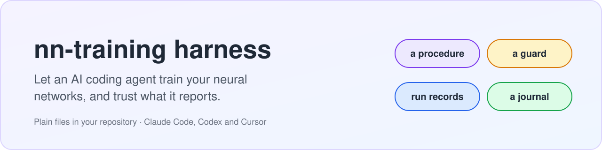
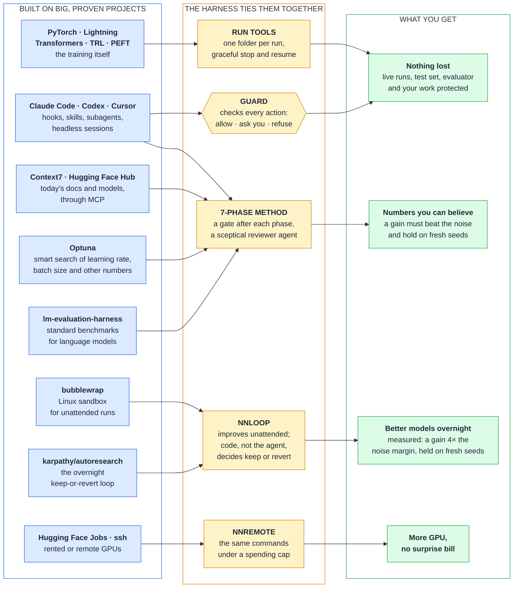

# nn-training harness

<picture>
  <source media="(prefers-color-scheme: dark)" srcset="docs/assets/banner-dark.svg">
  
</picture>

Install this kit into any machine-learning repository. Your AI coding agent (Claude Code, Codex or Cursor) then
runs, compares and improves your training by a careful method, and a guard stops the classic mistakes before they
happen: killing a live run, reading the test set, editing the evaluator to "win", calling a lucky run progress.

> One command to install · Python 3.8+, standard library only · no account, no service · tested on Windows and WSL2

## How it works

Each big project does the job it is best at. The harness adds what none of them has alone: a guard that checks
the agent's every action, one record for every run, and a rule that a gain counts only when it beats the noise.
The core needs none of the projects on the left except your agent; each of the others is optional and off until
you turn it on.

[autoresearch](https://github.com/karpathy/autoresearch) ·
[Optuna](https://github.com/optuna/optuna) ·
[PyTorch](https://github.com/pytorch/pytorch) ·
[Lightning](https://github.com/Lightning-AI/pytorch-lightning) ·
[Transformers](https://github.com/huggingface/transformers) ·
[TRL](https://github.com/huggingface/trl) ·
[PEFT](https://github.com/huggingface/peft) ·
[lm-evaluation-harness](https://github.com/EleutherAI/lm-evaluation-harness) ·
[Context7](https://github.com/upstash/context7) ·
[Hugging Face Jobs](https://huggingface.co/docs/huggingface_hub/guides/jobs) ·
[bubblewrap](https://github.com/containers/bubblewrap)

## What it changes
| Left alone, an agent may | With the harness |
|---|---|
| stop or restart a run that has trained for days | It asks you first, and a stop saves a checkpoint |
| read the test set | Refused: the test data is sealed |
| edit the evaluator until the number improves | It asks you first: the evaluator is frozen |
| keep a "gain" that was only luck | A gain must beat the measured noise and hold on fresh seeds |
| run `git reset --hard`, push, or change packages under a live run | It asks you first |
| forget what it did after a long session | A journal keeps every experiment, and the live status is shown at every start |

## Measured, not promised
- **Far fewer false wins.** A change that does nothing beats the baseline in a one-run comparison about half the
  time, and a loop that keeps changes on one run's score, as autoresearch does, keeps those. The harness's keep
  rule let such a change through in 2.1 to 2.3 % of simulated comparisons.
- **Real gains that held.** In an unattended campaign, what the loop kept was still better on fresh seeds:
  validation loss 1.695 → 1.641, about four times the noise margin. One campaign, on one task.
- **Not a smarter agent.** On a short task (12 runs of 30 seconds) the agent scored no better with the kit than
  without it. The pay-off is trust and protection on work that runs for hours or days.

How each was measured: [the guide](docs/GUIDE.md#what-was-measured) and [the report](docs/upgrade/REPORT.md).

## Get started
Where your Python is called `python3`, use that name in the commands below.

**1. Try it in ten minutes**, with nothing of yours at risk. It needs PyTorch. In the kit's folder:
```bash
python benchmarks/new_project.py ../charlm-try
```
That makes a practice project next to the kit: a tiny language model that trains in 30 seconds, with the harness
installed. In the new folder, start a run and watch it to the end:
```bash
python .claude/skills/nn-training/scripts/expctl.py launch --name first-try --seed 1 -- python train.py --seed 1 --time-budget 30
```
```bash
python .claude/skills/nn-training/scripts/expctl.py watch all --until terminal
```

**2. Install it in your repository.** The first command only shows what would change; the second makes the change.
Add `--agents all` for Codex and Cursor.
```bash
python install.py --target /path/to/your/repo --dry-run
```
```bash
python install.py --target /path/to/your/repo
```

**3. Start your agent.**
1. Restart the agent in your repository, so that it loads the guard. Codex: approve the two hooks once in `/hooks`.
2. Check the set-up: `python .claude/skills/nn-training/scripts/expctl.py selftest` must print `"ok": true`.
3. Fill in the Project card at the top of [KICKOFF_PROMPT.md](KICKOFF_PROMPT.md) and paste the whole prompt into
   the agent.

From there the agent works through seven phases: look around, wire in the run tools, freeze the rules, measure a
baseline and its noise, improve one change at a time, confirm and run the final test once, hand over. You answer
its questions and approve the steps that matter: stopping a run, the final test, anything that costs money.
`expctl.py status --brief` shows what is running at any time.

**Later, if you want:** let it improve on its own overnight with `nnloop`
([scenario G](docs/GUIDE.md#g-an-unattended-campaign-with-nnloop)), or train on rented GPUs with `nnremote`
([scenario H](docs/GUIDE.md#h-more-gpu-than-you-own-with-nnremote)).

## Learn more
| Read | For |
|---|---|
| [The guide](docs/GUIDE.md) | How it works step by step, and thirteen scenarios from a practice project to rented GPUs |
| [The training guide](docs/TRAINING_GUIDE.md) | How to get the best model: measurement, data, the starting model, the tool stack |
| [The reference](docs/REFERENCE.md) | What gets installed, what works with which agent and platform, upgrading and removing, every known limit |
| [The procedure](.claude/skills/nn-training/SKILL.md) | What the agent follows: seven phases, a gate after each |

## Licence
MIT: [LICENSE](LICENSE). The data of the two practice tasks keeps its own terms. Tiny Shakespeare is in the public
domain. Banking77 is under [CC BY 4.0](https://creativecommons.org/licenses/by/4.0/); its source, its citation and
the changes made to it are in [benchmarks/finetune/README.md](benchmarks/finetune/README.md).
