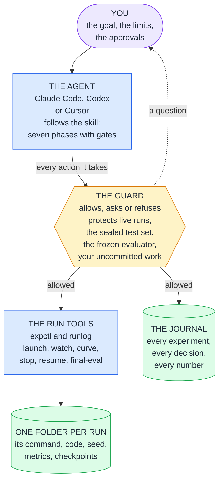

# nn-training harness for Claude Code, Codex and Cursor

<picture>
  <source media="(prefers-color-scheme: dark)" srcset="docs/assets/banner-dark.svg">
  
</picture>

A small, tested kit that you install into a machine-learning repository so that an AI coding agent trains neural
networks carefully. The agent can launch, watch, stop, resume, compare and explain experiments, and a guard hook
keeps it from the classic agent failures: killing or overwriting live runs, reading the test set, editing the
evaluator to "win", destroying uncommitted work, changing dependencies under a running study.

> One command installs it · Python 3.8 or newer, standard library only · no service, no account, no network ·
> Claude Code, Codex and Cursor · tested on Windows and WSL2

> [!TIP]
> **New here? Start with [the guide](docs/GUIDE.md).** It says in plain language what the kit is, how it works
> step by step, how it improves training and what was measured. Then it shows how to use it, from a ten-minute
> practice project to rented GPUs.

**On this page:** [How it fits together](#how-it-fits-together) ·
[What it changes](#what-it-changes) ·
[What was measured](#what-was-measured) ·
[Quick start](#quick-start-5-minutes) ·
[Try it first](#try-it-first) ·
[Documentation](#documentation) ·
[What gets installed](#what-gets-installed) ·
[What works where](#what-works-where) ·
[Notes and limits](#notes-and-limits) ·
[Licence](#licence)

## How it fits together

You give the goal, the limits and the approvals. The agent does the work, by a written procedure. Each thing it
does passes the guard first, which lets it through, asks you, or refuses. Training goes through one tool, so every
run leaves the same complete record, and every decision goes into the journal. The pieces:

- **Prompt** (`KICKOFF_PROMPT.md`): mission, priorities and deliverables. Short on purpose.
- **Rules block**: invariants that must hold all session long (re-read after compaction).
- **Skill**: the procedure, loaded when training work starts; a reference loads only when a phase needs it. Every
  reference carries a `Checked:` date and a `Refresh:` line, and a claim older than about six months is a lead to
  verify, not a fact.
- **Hooks**: deterministic enforcement of the non-negotiables (prompts are advice; hooks are rules).
- **expctl + runlog**: a uniform run contract, so that status, waiting, curves and comparisons cost little context.
- **Subagents**: an independent reviewer (agents grade their own work too kindly) and an analyst that reads raw
  logs so that the main context stays clean.

The guide follows one project through all of this, from the installation to the final result:
[How it works, step by step](docs/GUIDE.md#how-it-works-step-by-step).

## What it changes
| Left alone, an agent may | With the kit |
|---|---|
| stop, kill or restart a run that has trained for days | You are asked first, and a stop lets the run save a checkpoint and end |
| read the test set | Refused: the test data is sealed |
| edit the evaluator until the number improves | You are asked first: the evaluator is frozen |
| report a lucky run as an improvement | A change counts only when it beats the measured run-to-run noise, and the best result is trained again on fresh seeds |
| run `git reset --hard`, push, or change packages under a running study | You are asked first |
| lose the thread after a long session | The journal holds every experiment, and the live run status is shown at every session start |

The guide has the [full table](docs/GUIDE.md#what-it-changes), with what holds each line: a program that
refuses, or an instruction that a reviewer checks. [What works where](#what-works-where) below says which is
which for every agent and platform.

## What was measured
The kit applies its own rule to itself: a claim needs a measurement. In short, from November 2026, on one machine
with one GPU and Claude Code as the agent:

- **No better score on a short task.** On a small benchmark with at most 12 training runs of 30 seconds, an agent
  with the kit scored no better than the same agent without it. The differences lie inside the run-to-run noise.
- **Gains that held.** In one unattended campaign of the kit's loop, what the loop kept was still better on fresh
  seeds: validation loss 1.6948 against 1.6407, a gain of 0.054 against a noise margin of 0.013. That is one
  campaign on one task.
- **So expect trust and protection, not a better number.** The kit pays off on work that runs for hours or days.

The guide has [every measurement with its limits](docs/GUIDE.md#what-was-measured), and
[docs/upgrade/REPORT.md](docs/upgrade/REPORT.md) has the method.

## Quick start (5 minutes)
The core needs only Python 3.8+ (standard library, no network). Everything that needs a package, an account, a
network service or money is optional and off until you enable it. Last checked on 11 Nov 2026 against Claude Code
2.1.303, Codex CLI 0.167 and Cursor's documentation of that date; the first version is from 23 Oct 2026.
```bash
# review every change first
python3 install.py --target /path/to/your/repo --dry-run
# install for Claude Code; add --agents all for Codex and Cursor
python3 install.py --target /path/to/your/repo
```
On native Windows call it with `python`. The installer checks the interpreter and writes it into every installed
file that calls one (`--python-cmd CMD` chooses another; prefer a path without spaces; an upgrade keeps the one the
earlier install used). Then:
1. Restart the agent in the repository so the hooks load. Codex: trust the project and approve the two hooks once
   in `/hooks`. Claude Code: `/hooks` shows them.
2. Run `python3 .claude/skills/nn-training/scripts/expctl.py selftest` (hooks registered, guard deciding, status
   working).
3. Paste `KICKOFF_PROMPT.md` with the Project card filled in. For Claude Code set a high effort level first; the
   skill, not the prompt, carries the procedure.

## Try it first
Ten minutes, with nothing of yours at risk. In the kit's folder:
```bash
python benchmarks/new_project.py ../charlm-try
```
That creates a practice project beside the kit: a small language model that trains in 30 seconds, with the kit
installed, sealed test data and a frozen evaluator. It needs PyTorch. In the new folder, start a run by hand and
watch it:
```bash
python .claude/skills/nn-training/scripts/expctl.py launch --name first-try --seed 1 -- python train.py --seed 1 --time-budget 30
```
```bash
python .claude/skills/nn-training/scripts/expctl.py watch all --until terminal
```
```bash
python .claude/skills/nn-training/scripts/expctl.py status --brief
```
Then start your agent there and paste `KICKOFF_PROMPT.md`.
[Scenario A of the guide](docs/GUIDE.md#a-try-it-first-on-the-practice-project) goes through it, and through a
second practice project that fine-tunes a small chat model (`--task finetune`; it needs Transformers and PEFT, see
[benchmarks/finetune/README.md](benchmarks/finetune/README.md)).

## Documentation
| Read | For |
|---|---|
| [docs/GUIDE.md](docs/GUIDE.md) | What the kit is, how it works step by step, what it changes and what was measured. Then how to use it: set-up, what you decide, thirteen scenarios from a practice project to rented GPUs |
| [docs/TRAINING_GUIDE.md](docs/TRAINING_GUIDE.md) | How to get the best model: measurement, data, the starting model, the tool stack layer by layer, recipes |
| [KICKOFF_PROMPT.md](KICKOFF_PROMPT.md) | The prompt you paste to start a project, with its Project card |
| [.claude/skills/nn-training/SKILL.md](.claude/skills/nn-training/SKILL.md) | The procedure the agent follows: seven phases, a gate after each |
| [benchmarks/charlm/README.md](benchmarks/charlm/README.md), [benchmarks/finetune/README.md](benchmarks/finetune/README.md) | The two practice tasks: a small language model trained from scratch, and a chat model fine-tuned with LoRA. `benchmarks/pilot.py` measures on them whether the kit helps an agent |
| [docs/README.md](docs/README.md) | Everything else under `docs/`: research notes, review findings, the records of the upgrade |

## What gets installed
| Path in your repo | Purpose |
|---|---|
| `.claude/skills/nn-training/SKILL.md` + `references/` | The operating procedure (phases and gates) and 15 dated on-demand references: validity, data, evaluation, uncertainty, HPO, optimization, performance, resume, fine-tuning, LLM practice, operations, stack, scouting, loop, remote |
| `.claude/skills/nn-training/scripts/expctl.py` | Run controller: `status`, `launch`, `watch`, `curve`, `stop`, `resume`, `final-eval`, `hash`, `env`, `selftest` |
| `.claude/skills/nn-training/scripts/runlog.py` | Run-side logger for your training code (heartbeat, metrics, checkpoints, graceful stop, resume, HF/Lightning/Optuna helpers). Vendor a copy, as the skill does, or import it from there with the path built from `$EXP_PROJECT_ROOT`: a launched run works from a snapshot of the source that has no `.claude` |
| `.claude/skills/nn-training/scripts/nnloop.py`, `nnremote.py` | Optional modules: the unattended research loop and remote GPUs (below). Inactive until you configure them |
| `.claude/hooks/nn_guard.py` | The guard for all three agents (deny/ask), audit log in `.claude/state/guard.log` |
| `.claude/hooks/nn_session_status.py` | Injects live run status at session start, on resume and after compaction |
| `.claude/hooks/nn_statusline.py`, `nn_readonly.py` | Optional Claude Code status line; read-only rule for the two subagents |
| `.claude/agents/experiment-reviewer.md`, `run-analyst.md` | Sceptical read-only reviewer (Opus, high effort); log and curve analyst (Sonnet, medium effort) |
| `.claude/nn-training.json` | Harness config: metric, sealed and frozen paths, final-eval command, runs dir, interpreter |
| `.claude/settings.json` (merged) | Claude Code: hooks, allow rules for read-only `expctl` commands, ask rules for `git push` and Hugging Face tools that create or spend, deny rules for common secret files |
| `CLAUDE.md` or `AGENTS.md` (one marked block) | Eleven rules that survive context compaction. With Codex or Cursor the block lives in `AGENTS.md` and `CLAUDE.md` imports it |
| `--agents codex`: `.codex/hooks.json`, `.codex/agents/*.toml`, `.agents/skills/nn-training/SKILL.md` | Codex hooks, the two subagents, and a pointer to the skill |
| `--agents cursor`: `.cursor/hooks.json`, `.cursor/agents/*.md`, `.cursor/cli.json` | Cursor hooks, the two subagents (`readonly: true`), deny rules for the terminal agent |
| `experiments/JOURNAL.md`, `.claude/nn-training.manifest.json` | Project card and append-only journal; the record of what the installer wrote |

The installer writes only inside the target project. It never touches `~/.claude`, `~/.codex` or `~/.cursor`. The
one exception is an option you ask for: `--worktrees` (next table) writes one hook entry into the local settings of
the repository's other checkouts and one line into the repository's `.git/info/exclude`.

## Optional modules (each is one step)
| Module | Enable | Needs |
|---|---|---|
| Codex and Cursor ports | `install.py --target DIR --agents all` (or `codex`, `cursor`) | the agent |
| Claude Code status line | `install.py --target DIR --statusline` | |
| Guard for Claude Code sessions started in the repository's other checkouts (worktrees, or the main checkout when the kit lives in a worktree) | `install.py --target DIR --worktrees`; again after you add a worktree | git; "Notes and limits" says what it writes and what it cannot cover |
| MCP servers (Context7 docs, Hugging Face hub) | `install.py --target DIR --mcp` | network; the agent asks you to approve them |
| Research scouting | nothing to install: a step of the skill (`references/scouting.md`) | the agent's own web tools; without them it is skipped and the agent says so |
| Unattended research loop | add a `loop` section to `.claude/nn-training.json`, then `nnloop.py start --campaign NAME --agent claude --max-runs N` (`references/loop.md`) | git; a signed-in agent CLI; at least one limit (runs, hours, GPU-hours, money, tokens) |
| Remote and rented GPUs | add a `remote` section with a target and a spending cap, then `nnremote.py launch --name NAME --on TARGET -- ...` (`references/remote.md`) | ssh access to a machine, or a Hugging Face account that may run Jobs |
| Third-party stack (PyTorch, Optuna, lm-evaluation-harness, PEFT/TRL, Trackio) | per row in `references/stack.md`, in the project's own environment | packages, network |

The loop decides keep or revert in harness code, from a score it gets by running your frozen evaluator itself, and
stops at the first limit. Sealed test data is absent from the loop's worktree and the guard denies it; a Claude Code
worker has no shell, a Codex worker has one and is held from that data only by the guard and the transcript scan
(`references/loop.md` says what is enforced where). A remote run obeys the same commands as a local one,
starts nothing paid without a cap that covers it, gets only the environment variables and files you name, and is
resumed from its last checkpoint after a preemption.

## What works where
Words used: **enforced** = a hook or the harness refuses mechanically; **instructions** = the agent is told, nothing
checks; **missing** = not available. Two rows of the first table stand for a list each:

- **Denied outright:** reading sealed test data, the configured final-evaluation command typed directly (it runs
  through `expctl final-eval`, which keeps a receipt of every use), a file-tool edit inside an active run directory,
  unreadable hook input.
- **Steps that need a person:** stop or kill, deleting runs or checkpoints, destructive git, push, edits of frozen
  or harness files, the final evaluation (`expctl final-eval`), dependency changes under live runs, paid compute,
  starting a campaign or a remote run. A shell command that writes into an active run directory belongs here too.

### By agent
| | Claude Code | Codex CLI | Cursor editor agent | Cursor terminal agent |
|---|---|---|---|---|
| How it was checked | documented hook payloads; two loop campaigns with headless `claude -p` sessions on native Windows (Claude Code 2.1.322, 11 November 2026), the guard hook active in every session; not run on Linux (see "Notes and limits") | payloads built from the documented input schema (`Bash` and `apply_patch` both carry `tool_input.command`); not captured live, not run live | documented hook payloads; not run live | documented; not installed on the test machine |
| Rules that survive compaction | `CLAUDE.md` block | `AGENTS.md` block | `AGENTS.md` block | `AGENTS.md` block |
| Skill and references | native skill | pointer skill in `.agents/skills/` | read from `.claude/skills/` | read from `.claude/skills/` |
| Denied outright | enforced | enforced after you approve the hooks in `/hooks` (note 1) | enforced (`failClosed`) | enforced (`failClosed`) |
| Steps that need a person | the guard asks you; refused under `dontAsk`, `bypassPermissions` or `NN_UNATTENDED=1` | refused (a Codex hook cannot ask): run the step yourself | refused (a hook cannot tell whether you are there): run the step yourself | refused |
| A session in another checkout that lacks the kit's settings | unguarded, unless `--worktrees` registered the guard there (run live on native Windows; Linux, macOS and the desktop app's worktree sessions rest on the documentation) | missing: unguarded | missing: unguarded | missing: unguarded |
| Read-only subagents | enforced | instructions | enforced by Cursor (`readonly`) | enforced by Cursor (`readonly`) |
| Run status at session start | works | works after hook approval | works | works |
| Rules for secret files and publishing | deny and ask rules in `.claude/settings.json` | missing: use Codex's sandbox and approval settings | missing | deny rules in `.cursor/cli.json` |
| Status line | `--statusline` | missing | missing | missing |
| MCP servers (`--mcp`) | `.mcp.json` | missing: Codex keeps them in `~/.codex/config.toml`, which the installer leaves alone | `.cursor/mcp.json` | `.cursor/mcp.json` |
| Unattended loop | built: explicit tool list, approvals never bypassed; run live on native Windows (note 2) | built, not run live; stops if the guard hook did not run | not applicable | only with `--in-container`: it edits unattended only with `--force`, so it needs a container without credentials |
| Loop limits it can measure | runs, hours, GPU-hours, money, tokens | runs, hours, GPU-hours, tokens | | runs, hours, GPU-hours |

- **Note 1, Codex:** if a hook does not load, Codex runs without it. On native Windows start Codex from the project
  root: the hook path is relative to it, and from another folder the interpreter cannot find the hook script and
  exits with the code Codex reads as a refusal, so every call is refused (not verified live).
- **Note 2, the loop with Claude Code:** tested with a stand-in CLI and run live with headless `claude -p` sessions
  on native Windows (three campaigns: two stopped at their run limit, the third ended itself when two sessions in a
  row proposed no change, and its kept changes held on fresh seeds); not run live on Linux, where the CLIs of the
  test machine were not signed in.

Other surfaces (cloud agents, Claude Code on the web, Codex cloud, Cursor background agents) run outside your
machine: the kit's hooks and local GPU are not there, so use them for reading and planning only. Gemini CLI and
OpenCode are not ported.

### By platform
| | Linux | WSL2 | macOS | native Windows |
|---|---|---|---|---|
| Tests of 11 Nov 2026 | not run on bare Linux; WSL2 Ubuntu 24.04 stands in | all pass: Python 3.8 and 3.12 without third-party packages, 3.12 with psutil | not run | all pass: Python 3.8 without third-party packages, 3.11 with psutil |
| Run contract, guard, installer, session status | works | works | expected to work | works |
| `launch --via tmux` | works | works | expected to work | missing (no tmux): runs are detached processes |
| Graceful stop | SIGTERM and `stop.json` | same | same | `stop.json` only: a loop that does not poll `RunLog.should_stop()` is killed after `kill_after_s` |
| Source snapshot | symlinks | symlinks | symlinks | junctions and hard links when the account lacks the symlink privilege (local NTFS) |
| Loop: no network for the run, project read-only for the run, sealed data hidden from the run | enforced with bubblewrap | enforced with bubblewrap | missing: offline variables and a scan of the change only | missing: same |
| Loop: harness-side score, keep rule, limits, fresh worktree, ledger | enforced | enforced | enforced | enforced |
| Loop: evaluator, data and harness files unchanged by a run | enforced with bubblewrap (the project is read-only for the run), and checksummed | same | checked after the fact: a run is not confined, so a changed protected file is caught at the next checksum, and a change to something the evaluator imports from outside the protected paths (an installed package) is not caught | same as macOS; `link_paths` are junctions or hard links there, so a run can write the project's own data through them |
| Remote runs | works | works | expected to work | works as the controller; an ssh target needs a POSIX shell on the remote side |

Slurm: there is no Slurm target type; an ssh target to a login node with your own `srun` line is the route, and it
is not tested. Containers: no image ships with the kit; `--in-container` is your statement that the loop already
runs inside one.

## Upgrading and removing
- Upgrade: run the new `install.py` over the old install (same command). It keeps the values in
  `.claude/nn-training.json` (new keys and new protected paths are added), the journal, the run directories and
  your own settings; rewrites the kit's hook entries to the current form and names what it changed; replaces kit
  files, including ones you edited after install, and names each of those with its backup in
  `.claude/backups/nn-training-<timestamp>/`. Training scripts that import `runlog` and commands that call
  `expctl.py` at the skill path keep working. An upgrade without `--worktrees` writes nothing in the other
  checkouts and names each entry there that an earlier `--worktrees` run left in an older form. A settings file
  of yours that is not valid JSON, or whose hooks are not in the form its agent documents, stops an install or an
  upgrade before anything is changed; hook events in a form of your own that the kit does not write are kept.
- Remove: `install.py --target DIR --uninstall` deletes what the install wrote (files you edited stay), strips the
  hooks and the marked block, and keeps your config, journal, runs, backups, permission rules and `.gitignore` lines.
  It also takes the `--worktrees` entries out of the other checkouts' local settings (a file that held nothing else
  is deleted; the line in `.git/info/exclude` stays). The hook entries go before the scripts they run, and an
  entry in another checkout that cannot be taken out stops the removal with the kit still in place, because an
  entry without its script blocks every tool call. Run it before you move or delete the project folder.

## Using expctl yourself
```bash
E="python3 .claude/skills/nn-training/scripts/expctl.py"
$E status --brief                                   # what is running, best runs, alerts
$E launch --name lr3e-4 --seed 1 --note "hypothesis" -- python train.py --lr 3e-4 --seed 1
$E watch <run> --until terminal                     # event stream until it finishes
$E curve <run> --keys train/loss,val/acc
$E stop <run> --wait 5m                             # graceful: checkpoint, then exit
$E resume <run>                                     # a new run from the old run's checkpoint
$E final-eval -- --ckpt runs/<run>/ckpt/best.pt     # once, with a receipt and a journal entry
```

## Configure the protocol (Phase 2 does this with your approval)
Edit `.claude/nn-training.json`: `metric` (`name`, `direction`, `select`), `sealed_paths` (e.g. `"data/test/**"`),
`sealed_tokens` (e.g. `"NN_UNSEAL_TEST"`), `frozen_paths` (evaluation, metric and split code),
`final_eval_commands` (e.g. `"NN_UNSEAL_TEST=1 python -m eval.final"`: one program call without shell syntax, which
`expctl final-eval` runs once and records in `.claude/state/final-eval/`), `optuna.storage`. For Claude Code add
matching `Read(...)`/`Edit(...)` deny rules for the sealed paths in `.claude/settings.json`.

## Testing the kit
```bash
for t in test_runlog_units test_kit test_review_fixes test_ports test_loop test_remote test_benchmarks; do python3 tests/$t.py; done
```
Ten to fifteen minutes, CPU-only fake runs in temporary projects, no network, no accounts, no GPU. Each file prints
`PASS`/`FAIL` lines and `RESULT: ALL PASS`. `test_ports` covers the installer (install, upgrade over the 23 October
version, uninstall) and the guard's answers for each agent; `test_loop` the loop with a stand-in agent;
`test_remote` the remote module with stand-in `ssh` and `hf` commands; `test_benchmarks` the two benchmark tasks'
data and their project creator. `benchmarks/pilot.py` compares an agent with
this kit, with the 23 October kit and with no kit on the benchmark task (it uses your agent subscription, and
stops when the agent reports that further usage would be billed per use). Two pilots, with two and with five runs
per arm, on one task, one machine and one model, are in `docs/upgrade/REPORT.md`, section 2: this kit's edge over the
23 October kit (0.0044 in test loss with five runs per arm, p = 0.54) is not more than the run-to-run noise, and
neither kit was shown to beat running the agent with no kit.

## Notes and limits
- The guard is a seatbelt, not a sandbox: a program can still build a path at run time. For hard isolation keep
  the test split outside the repository, or use the agent's own sandbox with read-deny rules (test GPU access
  inside it first).
- Recursive commands over the project root (`grep -r`, `rgrep`, `find`, `ls -R`, `tree`, `tar`, `zip`, `cp -r`,
  `cp -a`, `rsync`, a path with `**` in it such as `cat **/*.csv`; in PowerShell and cmd.exe `Get-ChildItem -Recurse` with
  its short forms, `dir /s`, `findstr /s`, `tree /f`, `Copy-Item -Recurse`, `Compress-Archive`, `robocopy`, `xcopy`,
  a .NET call with `AllDirectories`) are asked about when sealed files lie below it on disk, as in every folder
  below the root. So is a move or a rename of a folder that holds sealed files (`mv`, `git mv`, `Move-Item`,
  `Rename-Item`, `ren`): under another name nothing would seal them. A recursive command passes when it names the folders it needs
  (`grep -rn x src tests`, `Get-ChildItem src,tests -Recurse`) or gives a file filter that leaves the sealed files
  out (`--include='*.py'`, `-name '*.py'`, `--exclude-dir=data`, `-Filter '*.py'`, `-Include '*.py','*.md'`). `rg`
  and the agent's own Grep tool pass where git's ignore rules keep ripgrep away from the sealed files. They do not
  when the command turns the rules off (`rg -u`, `--no-ignore`, `git grep --no-index`), follows links (`rg -L`) or
  names files to include that match the sealed files or their ignored folder: `rg -g '*.csv'` reads a csv file that
  git ignores by a rule for the file (`*.csv`), while a rule for the folder (`data/`) holds (compared with ripgrep
  15.1 and Claude Code's Grep tool on Windows, 12 November 2026). Nor do they pass where ripgrep's own files take
  the rule back: a `.ignore` or `.rgignore` file, beside the ignored folder or in a folder above it, with a `!`
  line for its name, or a configuration file named by `RIPGREP_CONFIG_PATH` that turns the rules off, follows
  links or names files to include (`rg --no-config` sets that file aside; compared with ripgrep 15.0, 13 November
  2026). The guard reads each command of a line by
  itself and follows `cd`, `pushd` and `popd`, subshells, `git -C` and `env -C`. A path that names nothing where
  the line runs is read from every folder the line names as well, so that a sealed file reached through a
  program's own change of folder is refused (`sudo -D data cat test/x.csv`, `tar -C data -c test/x.csv`,
  `python train.py --data-dir data --eval-file test/x.csv`). Each tool's filters are read that tool's way (grep's
  `--include` and `--exclude` in their order, find's `-name` with `-o` and `-not`, ripgrep's `-g` and `-t`), and
  the target of a redirection (`2>/dev/null`) or the value of an option does not count as a folder the command
  names. `ls -r` and `dir -s` count as recursive wherever the shell may be PowerShell (Claude Code's PowerShell
  tool, Codex, Cursor, a line that names `powershell`, `pwsh` or `cmd`), and not in Claude Code's Bash tool, which
  runs a POSIX shell. Limits: it does not read depth options (`find -maxdepth 1`, `tree -L 2`, `-Depth 1`; only
  `-Depth 0` is read as one folder), PowerShell's
  `-Exclude`, the exclusions of `tar`, `zip` and `rsync` or a wildcard path (`gci -r *.py`), so those are asked
  about at the root as well, as is a search with a long option the guard does not know in front of its folders;
  behind a wrapper it does not know (`xargs`, `wsl`, `ssh`) a search of the root with a Unix tool is not
  questioned, only one of a folder below it; a path given through a variable (`$DIR/data`) is not followed; a
  command word spliced from quoted pieces, quoted with a blank in its path or quoted behind a wrapper with a
  word for an option (`g'r'ep`, `"C:/Program Files/Git/usr/bin/grep.exe"`, `sudo -u me "grep"`), is not
  recognised, and a `**` that stands alone is not read as a
  path (`ls **` under bash's globstar); a link that one line makes and reads through (`ln -s data d2; cat d2/…`)
  is not followed, as it is in every later call; a heredoc line that starts with `find` or `tree` is read as a command;
  a command line inside one quoted argument (`Start-Process -WorkingDirectory data cmd '/c type test\x.csv'`) is
  not read; and program code that walks or moves the tree (`os.walk`, `shutil.move`, .NET's `Directory.Move`) is
  not parsed, .NET's `AllDirectories` excepted. One more limit, measured on 13 November 2026 with 19,000 and with
  20,500 files in front of a sealed one: the look on disk stops after 20,000 files per folder it walks, and a
  sealed file beyond them is not seen, so the command passes. Where a sealed pattern begins with `**/`, that is
  any recursive command or search over a folder, the project root included, in which more than 20,000 files come
  before the sealed one. Where a pattern names some files of a folder (`data/held/*.csv`), it is such a command at
  the project root, or the Grep tool from a folder above, when more than 20,000 other files of that folder come
  first. Where a pattern seals a whole folder (`data/test/**`), it is only a search with a file filter, when more
  than 20,000 files that the filter leaves out come before the one it matches (`grep -r --include='*.csv' x .`
  over a folder of 25,000 images and a label file). A sealed file that a command names is refused at any size.
  Keep a test split of that size outside the repository.
- Other checkouts of the repository: the guard applies the project's rules to run snapshots, to the main checkout
  and to every worktree that git has registered, wherever it lies (it reads the list from git's own files), and
  it combines their configs: what any checkout seals or freezes is sealed or frozen in all of them (closed and
  tested on 12 November 2026). A plain copy of the project, or a second clone in another folder, is a
  different project to the guard: its files are not covered from here. Keep the test split outside the
  repository if copies exist.
- Sessions started in another checkout: those rules reach the other checkouts' files, but they bind only a session
  in which the guard runs. Claude Code reads `.claude/settings.json`, and with it the hooks, from the folder the
  session starts in. A session started in a checkout without the kit's settings (a worktree on a branch without
  the kit, or the main checkout when the kit lives in a worktree) therefore runs unguarded and can read what the
  project seals there; so does one started in a subfolder of the project, so start the agent at the project root.
  `expctl selftest` warns when the repository has checkouts without the guard. `install.py --target DIR
  --worktrees` registers it for them: one hook entry in `.claude/settings.local.json` of each such checkout, and on
  Linux and macOS of the main checkout as well, because Claude Code reads
  that file from the session's folder on Windows and from the main checkout's root on Linux and macOS, and a
  worktree session started from its desktop app takes settings, hooks, skills and agents from the main checkout's
  root (code.claude.com/docs/en/settings and /worktrees, read 13 November 2026). The entry runs this project's guard with this project's config and audit log and does
  nothing in the project's own sessions. Git is told to ignore that file (one line in `.git/info/exclude`); a
  local settings file that git tracks, that cannot be read as settings or that cannot be written is left alone
  and named. Checked live on native Windows with a headless
  session in a worktree without the kit, once with the kit in the main checkout and once with it in another
  worktree (Claude Code 2.1.322, 13 November 2026): the session read a sealed file before the option was run and
  was refused after it, with the refusal in the kit checkout's guard log. Not checked live: Linux and macOS, and
  the desktop app's worktree sessions. Limits: Claude Code only; a worktree
  added later needs the installer again; a desktop-app worktree session gets the guard this way but the skill and
  the subagents only if the main checkout has them; each tool call in those checkouts costs one guard run, and on
  Linux and macOS each call in the project's own sessions one interpreter start; and if the project folder is
  moved or deleted while the entries exist, every tool call in those checkouts is refused, with a message that
  names the entry, until the kit is back or the entries are deleted (`--uninstall` removes them).
- Sealed data behind a link (a symlink or a junction, to storage outside the repository or into another
  checkout) is sealed at the link and at its real place, for reads and for searches. The guard judges a search
  by where the files really lie, as ripgrep does: a search of a linked data folder is refused even where git
  ignores the link (compared with ripgrep 15.2 on Windows, 12 November 2026). So if a link ends in a folder of
  another checkout that git does not ignore there, a search of that whole checkout is refused as well: keep
  linked data in a folder that git ignores, or outside the repository. A hard link to a sealed file cannot be
  told from its path; making one names the sealed file, which the guard refuses.
- Sealed files that git tracks are a gap. The guard checks the paths a command names (`git show <rev>:<path>`
  is refused), and git prints a tracked file without being given its name: `git log -p`, `git show <commit>`.
  Keep the test split out of git. `expctl selftest` warns when sealed paths are tracked; a line
  `<pattern> -diff` in `.gitattributes` keeps those two commands and `git diff` from printing the content
  (checked with git 2.52), not `git cat-file` or an archive. The loop's Claude Code sessions have no shell.
- The rule against starting the final evaluation directly compares commands. It knows the configured command
  after `cd`, in a chain and behind `py` or `cmd /c`; a wrapper script or an option with a value
  (`python -X dev ...`) gets past it. `sealed_tokens` is the stronger rule: a command that names the variable
  your evaluator needs for the test split is refused, however the rest of it is spelled.
- It fails safe: an unreadable hook input is refused; an unreadable config or an internal error turns every
  action, reads included, into a question (a refusal where nobody can be asked). So does a check that takes the
  guard longer than 12 seconds (a path on a server that does not answer, a line with very many different
  searches): its hooks give it 15 to 20, and not every agent blocks a call whose hook ran out of time. Claude Code
  older than 2.1.295 lacks the `onFailure` setting that blocks tool calls when the hook cannot run at all. Run
  `expctl selftest` after changes.
  The two subagents' own hook carries the same setting. Claude Code runs a project subagent's own hooks only in a
  folder whose trust dialog was accepted, and never in a `-p` session; the project-wide guard applies the
  read-only rule to their calls either way. Checked live with the two agents passed through `--agents` (Claude
  Code 2.1.322, native Windows, 12 November 2026): a hook that cannot run blocks the call with the setting and
  lets it through without. Not checked live: the agent files themselves in a trusted folder.
- The receipt of the final evaluation is a record, not a seal: it counts the uses that went through
  `expctl final-eval` in this checkout and in every worktree that git has registered, and a copy of its rows in
  git's common folder (`.git/nn-training-final-eval.jsonl`) keeps the uses of a worktree that was removed.
  Deleting `.claude/state/final-eval/` and that copy resets the count (the guard asks before a command or an edit
  touches either; the journal entry of each use remains).
- A plain `expctl launch` hands the run your whole environment. The loop withholds variables whose names look like
  secrets, and a remote run gets only the variables you name.
- An interpreter path with spaces is quoted in hook commands; PowerShell and Codex on Windows cannot run that form.
- Not verified live: the loop with Claude Code on Linux (it ran live on native Windows only); a loop stop caused
  by a rate limit, a usage cap or paid usage (tests only); Codex and Cursor sessions; the Hugging Face Jobs route
  (it needs your account and a paid canary: `references/remote.md`); macOS and bare Linux.
- A campaign's best score is selected among many tries on one validation split, so it is biased upward. A campaign
  that kept something therefore ends with a confirmation: the loop trains the start and the kept version on fresh
  seeds and reports whether the gain holds. Once a change is kept, the loop holds back the runs for that from the
  run and time limits (two seed panels), so a small run limit leaves fewer iterations; `"confirm": false` in the
  `loop` section turns it off. It uses the validation split, so follow Phase 5 before you claim a result.
- The loop's keep rule is strict when a campaign is young. With three seeds a change must gain 2.3 run-to-run
  deviations at first and 1.7 after eight seed panels. A gain above two thirds of that margin is measured on a
  second seed panel and decided on all seeds; late in a campaign that can use the runs the confirmation needs,
  which is then reported as not run until `nnloop resume` with a higher limit. In simulation one comparison keeps a change without effect in
  2.1 to 2.3 % of cases and a real gain of two deviations in about 60 % at a campaign's first change and about
  80 % once several panels are behind the noise estimate. The confirmation is a single look and
  confirms such a gain in about half of the cases. More seeds buy power, at the cost of runs
  (`references/loop.md`, "The keep rule").

## Licence
The kit's code and documents are under the MIT licence: [LICENSE](LICENSE). The data of the two practice tasks
keeps its own terms. Tiny Shakespeare is in the public domain. Banking77 is under
[CC BY 4.0](https://creativecommons.org/licenses/by/4.0/); its source, its citation and the changes made to it
are in [benchmarks/finetune/README.md](benchmarks/finetune/README.md).
