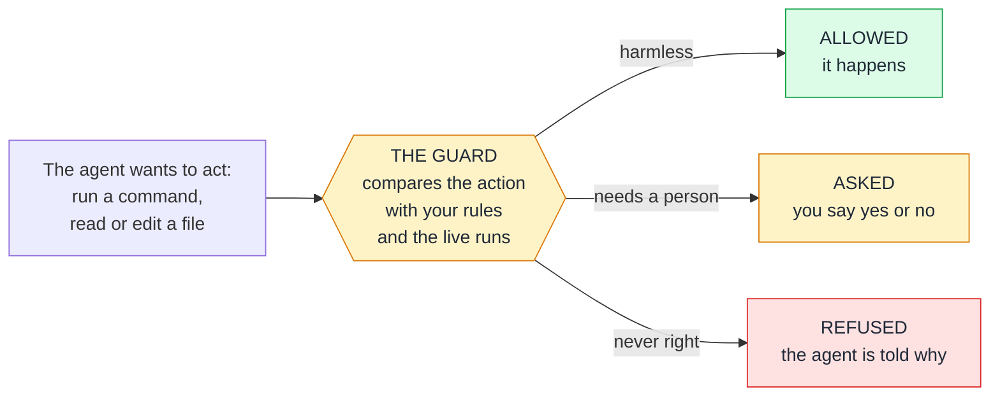
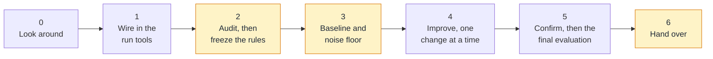
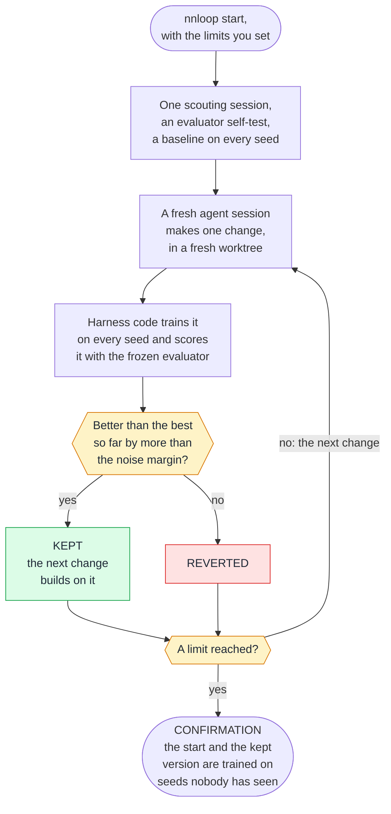

# The nn-training harness: a plain guide

You have a machine-learning repository and an AI coding agent (Claude Code, Codex or Cursor). The agent can write
training code and run it. What it cannot do by itself is be trusted alone with your GPU for a night: it may stop
the wrong job, read the test set, change the evaluation until the number looks good, or report a lucky run as
progress.

**This kit fixes that.** It is a few plain files in your repository: a method the agent follows, a guard that
checks every action before it happens, tools that start and record every training run the same way, and a journal
that remembers. Nothing to run beside it, no account, no network.

| I want to | Read |
|---|---|
| understand what it does | [How it works](#how-it-works), five minutes |
| try it now, with nothing of mine at risk | [Start here](#start-here) |
| use it on my own project | [Working with the agent](#working-with-the-agent) |
| do one particular job (fine-tune, search, run overnight, rent GPUs) | [Scenarios](#scenarios) |
| look up a command, a limit or a word | [Quick reference](#quick-reference) |

<sub>Checked: 2026-11-14, against the kit as it stands in this repository. Refresh: when `README.md`,
`REFERENCE.md` or a file under `.claude/skills/nn-training/references/` changes, re-read the section here that
names it. Tool versions come from those references and age in weeks. The measurements come from
`docs/upgrade/REPORT.md`.</sub>

## How it works

You give the goal, the limits and the approvals. The agent does the work, following a written method. Everything
it does passes the guard first. Every training run goes through one tool, so every run leaves the same complete
record, and every decision goes into the journal. Five ideas make it work.

### 1. Every action passes the guard

The guard is an ordinary program, not an AI. The agent's own software hands it every command, read and edit
before it happens.

| The agent tries to | The guard |
|---|---|
| read or search the training code | allows it |
| read the sealed test set, or edit files inside a run that is still training | refuses |
| edit the evaluator or another frozen file | asks you |
| stop or kill a run, delete a run or a checkpoint | asks you |
| run `git reset --hard` or `git push`, or change packages while a run is live | asks you |
| start the final evaluation, or compute that costs money | asks you |

Every refusal and question is logged in `.claude/state/guard.log`. With Codex and Cursor a hook cannot ask a
person, so "asks you" becomes a refusal there, and the agent gives you the command to run yourself.

### 2. Every run leaves a complete record
The agent never starts training with a bare `python train.py`. It uses one command, and so can you:
```bash
python .claude/skills/nn-training/scripts/expctl.py launch --name first-try --seed 1 -- python train.py --seed 1
```
That gives the run its own folder, `runs/<id>/`, with its own copy of the code, so a later edit cannot change a
run that is under way. It starts in the background. A few lines of `runlog.py` in your training script record a
heartbeat, the metrics and the checkpoints.

| In `runs/<id>/` | What it holds |
|---|---|
| `manifest.json` | the command, the seed, the git commit, uncommitted changes, a hash of the source |
| `src/` | the copy of the code the run executes (sealed test data is left out) |
| `heartbeat.json`, `metrics.jsonl` | the run's pulse, and every metric it logged |
| `stdout.log` | everything the script printed |
| `result.json`, `exit.json` | the final values, and the exit code |

So months later any number can be traced back to the code, the command and the seed that made it. `status`,
`watch` and `curve` read those files and answer in a few lines. A stalled run, a failure, non-finite values or a
full disk raise an alert. A stop is a request: the run saves a checkpoint and ends, and `resume` continues it.

### 3. The agent works in seven phases

Each phase ends with a gate: a check that must pass before the next phase starts. The order is the point: first
fix the rules of comparison and measure the noise, then improve, and touch the test set only at the very end. You
get a report after each of the three highlighted phases.

### 4. A gain counts only when it beats the noise
Train the same code three times with three random seeds and you get three different scores, say a validation loss
of 1.70, 1.72 and 1.69 (lower is better). Those differences are pure luck. They scatter by about 0.015: that is the
**noise floor**.

| A change scores | What it means |
|---|---|
| 1.69 on one seed | Nothing: the untouched code scored 1.69 too |
| 1.69, 1.70 and 1.70 on the same three seeds | 0.007 better, less than half the noise. Not a gain |
| 1.65, 1.66 and 1.64 on the same three seeds | 0.053 better, about three and a half times the noise. A candidate |
| 1.65, 1.67 and 1.66 again, on three new seeds | Confirmed. Now it may be reported |

The method and a sceptical reviewer agent hold the agent to this rule. In the unattended loop a program applies it.

### 5. The test set is used once, at the end
Every number before the end comes from validation data, and the guard refuses every attempt to read the test set.
When the final recipe is written into the journal, one command runs the final evaluation. The guard asks you
first, a receipt is kept, and a second use needs a stated reason. A test set that is looked at twice is no longer
a test set.

**Two optional modules** do the same work without you: `nnloop` improves the code unattended
([scenario G](#g-an-unattended-campaign-with-nnloop)) and `nnremote` runs on remote or rented GPUs
([scenario H](#h-more-gpu-than-you-own-with-nnremote)). Both stay off until you set them up.

### What it does not do
- **It trains nothing by itself.** It works beside PyTorch, Transformers or whatever your repository uses.
- **It does not pick your data or your starting model.** Those matter more than any loop:
  [TRAINING_GUIDE.md](TRAINING_GUIDE.md) is about them.
- **The guard is a seatbelt, not a sandbox.** A program that builds a file path while it runs can get past it.
  Keep the test split outside the repository, and out of git, for hard isolation.
- **It binds only the sessions it runs in.** Start the agent at the project root.
- **Codex and Cursor are less proven than Claude Code.** No live session of either was run.

## What was measured
The kit holds itself to its own rule: a claim needs a measurement. November 2026, one machine, one GPU, Claude
Code as the agent. [REPORT.md](upgrade/REPORT.md) has the method behind each row.

| Question | Answer |
|---|---|
| Does an agent with the kit score better on a short task? | **No.** Five sessions per arm, at most 12 runs of 30 seconds each: test loss 1.7501 with the kit, 1.7425 without, 1.7568 untouched. All inside the noise |
| Are the loop's gains real? | **Yes, in the campaign of 12 November.** Two changes kept out of eleven. On fresh seeds the validation loss went from 1.6948 to 1.6407: a gain of 0.054 against a noise margin of 0.013 |
| And in the two earlier campaigns? | One change kept in each, gains of 0.013 and 0.009. On the test split both were about 0.009 better than the untouched script, close to the noise |
| How often does the loop keep a change that does nothing? | In 2.1 to 2.3 % of simulated comparisons. A one-run comparison lets such a change win about half the time |
| Does a search of numeric settings by the loop help? | **On one task of two.** Fine-tuning: confirmed accuracy gain 0.42 with it, 0.31 without. Character model: nothing kept either way. So it is off unless you turn it on |
| Does the guard hold? | Independent reviews found holes in every round, and each was fixed. What it still misses is in [REFERENCE.md](REFERENCE.md#notes-and-limits) |

**In plain words:** the kit does not make an agent cleverer, and on a six-minute task it bought no better score.
What it buys is numbers you can believe and work that is not lost. It pays off on training that runs for hours or
days. Every row is one task on one machine.

## Start here
**1. Try it on the practice project** (ten minutes, needs PyTorch). [Scenario A](#a-try-it-first-on-the-practice-project)
walks through it.

**2. Install it in your repository.** Use `python3` instead of `python` where that is your interpreter's name.
```bash
python install.py --target /path/to/your/repo --dry-run
```
```bash
python install.py --target /path/to/your/repo
```
The first command shows what would change; the second makes the change. It writes only inside your repository.
Add `--agents all` for Codex and Cursor, `--mcp` for the Context7 and Hugging Face servers, `--statusline` for the
Claude Code status line.

**3. Start the agent.**
1. Restart the agent in the repository so it loads the guard. Codex: approve the two hooks once in `/hooks`.
2. Run `python .claude/skills/nn-training/scripts/expctl.py selftest`. It must print `"ok": true`.
3. In Claude Code, use the strongest model you have at a high effort level for this session: it makes the design
   decisions.
4. Fill in the Project card at the top of `KICKOFF_PROMPT.md` and paste the whole prompt into the agent.

**Before the first session, decide three things.** They save hours later.
- **What "better" means:** the one metric that decides, and what you would trade for it (time, memory, size).
- **What may be spent:** which GPUs, how many GPU-hours, by when. Paid compute and unattended runs stay off unless
  you allow them, with limits.
- **Where the test data lives:** its own file or folder, so it can be sealed. Outside the repository is safer.

## Working with the agent
The agent follows the phases and stops at each gate. Here is what it does and what you do:

| Phase | The agent | You |
|---|---|---|
| 0 Look around | reads the repository, finds live jobs, fills the Project card in `experiments/JOURNAL.md` | answer one batch of questions |
| 1 Wire in the run tools | adds `runlog.py` to your training script, makes a short test run | nothing |
| 2 Audit and freeze | checks the splits for leaks, proposes the metric, the sealed and frozen files and the final command | approve the config edits |
| 3 Baseline and noise | trains the best affordable baseline on several seeds, measures the noise and the cost of a run | approve a budget |
| 4 Improve | researches ideas with sources, then tests one change at a time against the baseline | approve stops, deletions and package changes when asked |
| 5 Confirm and finish | re-runs the best on fresh seeds, then the final evaluation once | approve the final evaluation |
| 6 Hand over | writes the final report, the exact commands, the next experiments | read it |

The guard also asks you before destructive git, edits of the kit's own files, starting a campaign or a remote run,
and a few rarer cases (the full list is in [REFERENCE.md](REFERENCE.md#what-works-where)).

**Habits that get the most out of it**
- **Give the limits up front.** The agent then asks once instead of at every step.
- **Don't ask it to get around the guard.** If a rule is wrong for your project, change the config.
- **Read the three reports.** Each number in them names the run it came from.
- **Believe the confirmed gain,** not the best score of a search: the best of many tries is lucky on average.
- **Change one thing at a time,** at the same budget, on the same seeds.
- **No package changes while runs are live,** and one tracker, one search tool.
- **Treat what the agent reads on the web as ideas to test,** never as defaults.

## Which tool for which job
| You want to | Use |
|---|---|
| have an agent train carefully in your repository, any kind of model | this kit, with the framework your repository already uses ([scenario B](#b-an-existing-training-repository)) |
| fine-tune an open language model | this kit with Transformers, TRL and PEFT ([scenario D](#d-fine-tune-an-open-language-model-on-your-data)) |
| tune numbers such as the learning rate | Optuna, driven by the agent under the kit ([scenario F](#f-searching-numeric-settings)) |
| improve a small GPT overnight, on exactly the task autoresearch ships | [`karpathy/autoresearch`](https://github.com/karpathy/autoresearch) as it is: the least set-up for that task |
| the same overnight loop on your own task, with decisions you can believe | this kit's `nnloop` ([scenario G](#g-an-unattended-campaign-with-nnloop)) |
| train on more GPU than you own | this kit's `nnremote` ([scenario H](#h-more-gpu-than-you-own-with-nnremote)) |

**Why `nnloop` and not autoresearch on your own task?** It is the autoresearch pattern, rebuilt so that code
decides, not the agent. Autoresearch keeps a change on the score of one run, so some of what it keeps is luck, and
its README advises running the agent with permissions off. `nnloop` scores every change itself on several seeds,
keeps it only above the noise, and confirms the result on seeds nobody has seen. The price: each decision costs
three runs instead of one, and fewer changes are kept.

**Both on one repository?** No: each loop would commit, revert and score on its own. The agent's research step may
still take ideas from autoresearch and its forks as hypotheses to test.

**Don't run the agent itself on a local model** on the GPU you train on: the two compete for the card.

Every project that was considered, with its decision and reason, is in `docs/upgrade/LEDGER.md`.

## Scenarios

### A. Try it first on the practice project
In the kit's folder (it needs PyTorch):
```bash
python benchmarks/new_project.py ../charlm-try
```
This makes a practice project beside the kit: a tiny language model that trains in 30 seconds, with the kit
installed, sealed test data and a frozen evaluator. Nothing of yours is touched. In the new folder:

**By hand, no agent** (two minutes): check the wiring, start a run, watch it, read its curve.
```bash
python .claude/skills/nn-training/scripts/expctl.py selftest
```
```bash
python .claude/skills/nn-training/scripts/expctl.py launch --name first-try --seed 1 -- python train.py --seed 1 --time-budget 30
```
```bash
python .claude/skills/nn-training/scripts/expctl.py watch all --until terminal
```
```bash
python .claude/skills/nn-training/scripts/expctl.py curve first-try --keys train/loss,dev/loss
```
`selftest` prints `"ok": true` when everything required works. It also flags one optional item: the practice
project keeps its sealed files in git. `watch` prints a line per event and stops when the run ends; on the test
machine the validation loss fell from 2.44 to 1.40. `status --brief` then lists the run as the best so far.

**With the agent:** start it in the new folder, fill in the Project card of `KICKOFF_PROMPT.md` and paste the
prompt.

**Unattended:**
```bash
python .claude/skills/nn-training/scripts/nnloop.py start --campaign first --agent claude --max-runs 40 --max-hours 2
```
The campaign's agent sessions use your subscription. Without `--max-usd`, the loop stops as soon as Claude Code says
further use would be billed.

A second practice project fine-tunes a small chat model with LoRA: run `python benchmarks/finetune/fetch_model.py`
once (270 MB), then `python benchmarks/new_project.py DIR --task finetune`. It needs PyTorch, Transformers and PEFT.

### B. An existing training repository
1. Install, restart the agent, run the self-test ([Start here](#start-here)).
2. Fill the Project card. Name the live jobs the agent may touch; by default it touches none.
3. Paste the kickoff prompt, and let Phases 0 to 3 finish before you ask for improvements: the noise measured in
   Phase 3 is what tells a real gain from luck.
4. Keep your framework, environment manager and tracker. The kit adds a new tool only for a stated benefit.

### C. A new project from an idea and some data
The kit does not create a project for you. First:
1. `git init` a repository and put the data in, with the test split set apart.
2. Create the environment with a lock file (`uv` with a committed `uv.lock` is recommended).
3. Install the kit, and say in the Project card what you want and that there is no training code yet.
4. Ask for the simplest baseline first, with at least a tuned learning rate.

Then continue as in B. [TRAINING_GUIDE.md](TRAINING_GUIDE.md) helps decide what kind of training the idea needs.

### D. Fine-tune an open language model on your data
A good run of it looks like this:
1. **Baselines first:** the untuned model with a fixed prompt, and a trivial predictor, both scored by the frozen
   evaluator. The task metric decides, not the loss.
2. **Choose the base model** by where it must run and what its licence allows. Score two or three sizes untuned
   first. A licence that is unclear, non-commercial or gated is a question for you.
3. **One pinned training stack per environment.** On 11 November 2026: Transformers 5.22.2, TRL 1.17.1,
   PEFT 0.21.2, bitsandbytes 0.50.2.
4. **Check the chat template before any long run:** render three training examples exactly as the trainer does,
   and read them. Most silent fine-tuning failures hide here.
5. **Find the memory fit by trying** one step on the longest sequence at the real batch size.
6. **Start with LoRA** on all linear layers and sweep the learning rate. Load in 4 bits (QLoRA) only when 16 bits
   do not fit.
7. **Compare on seeds, confirm, evaluate once** ([scenario J](#j-finishing-the-one-final-evaluation)), and score the
   exported model again: a merged or quantised model is a new model.

A Project card for this case:
```text
- Goal: answers to support tickets in our house style; quality first, the model must run on one 24 GB card
- Primary metric and direction: exact-match on data/val.jsonl, higher is better
- Compute you may use now: the local GPU, 20 GPU-hours, by Friday
- Paid or cloud spend allowed: none
- Unattended campaign allowed: none
- Hard constraints: licence must allow commercial use; no data leaves this machine
```
On native Windows, bitsandbytes was not re-checked, and vLLM does not run (use WSL2 for it).

### E. A small model from scratch
Good as a research benchmark or a small model for one domain; one GPU will not make a general assistant this way.
Give every experiment the same time budget, keep data, tokenizer and evaluation in files the agent may not edit,
and let it edit the training file: that is [scenario G](#g-an-unattended-campaign-with-nnloop) on your own script. A
fixed budget favours changes that are fast, so test what the loop kept at your real budget before you merge it.

### F. Searching numeric settings
"Tune with numbers, think with words." For settings that are only numbers, the agent uses your project's search
tool, or Optuna when there is none, and lets the search choose the values. The learning rate comes first. The best
trial is lucky on average, so the top three are trained again on fresh seeds before a decision. Set
`optuna.storage` in `.claude/nn-training.json` (for example `sqlite:///experiments/optuna.db`) and `expctl status`
lists your studies. `references/hpo.md` has the details.

### G. An unattended campaign with `nnloop`
For cheap runs (seconds to minutes each), after Phases 0 to 3, when you trust the evaluator. The project must be a
git repository with the kit's files committed.

**1. Add a `loop` section** to `.claude/nn-training.json` (the agent can propose it; the guard asks you). The
practice project's section, which is tested:
```json
"loop": {
  "task": "Lower the held-out loss of the model that train.py trains ... A run must save model.ts ...",
  "train_command": ["{python}", "train.py", "--seed", "{seed}", "--time-budget", "30"],
  "eval_command": ["{python}", "evaluate.py", "--data", "data/loopval.txt", "--run-dir", "{run_dir}"],
  "direction": "minimize",
  "seeds": [1, 2, 3],
  "run_budget_s": 90,
  "editable_paths": ["train.py"],
  "min_margin": 0.005
}
```
The evaluator must be a frozen file that reads a validation split and prints a last JSON line with a `score`. If
that split is in `sealed_paths`, the agent cannot even see the data that decides.

**2. Start it with at least one limit,** then check on it or stop it:
```bash
python .claude/skills/nn-training/scripts/nnloop.py start --campaign NAME --agent claude --max-runs 60 --max-hours 8 --detach
```
```bash
python .claude/skills/nn-training/scripts/nnloop.py status --campaign NAME
```
```bash
python .claude/skills/nn-training/scripts/nnloop.py stop --campaign NAME
```

**3. Read the verdict** in `nnloop status` and the journal. Claim the gain the confirmation measured, not the best
score along the way. Kept code sits on the branch `nnloop/NAME`; nothing is merged for you.

| Verdict | What to do |
|---|---|
| `confirmed` | have the reviewer read the kept changes, test at your real budget, then [scenario J](#j-finishing-the-one-final-evaluation) |
| `unclear` | run both versions on more seeds before relying on it |
| `not_reproduced` | treat the change as noise |
| `not_run`, `unfinished`, `failed` | `nnloop resume` with limits that leave room for the confirmation |

**Good settings**
- **Three seeds or more.** With three, the first change must gain 2.3 run-to-run deviations to be kept (with two,
  4.5). A change that does nothing gets through about 2 times in 100.
- **A run limit well above 15** (five rounds of three seeds): the confirmation needs room once something is kept.
- **A mid-tier model at moderate effort** for the loop's sessions (`--model`, `--effort`): each makes one small edit.
- **Leave the project folder alone** while a campaign runs: a changed file stops it.
- **Optional extras,** off unless set: `loop.search_trials` lets the loop search numbers itself (it helped on one
  task of two), and `loop.restart_after` goes back to an earlier commit and tries another direction when nothing is kept
  for a while.
  `references/loop.md` explains both.

On Linux and WSL2 with bubblewrap a run has no network and sees the project read-only. On native Windows and
macOS those two are not enforced: a changed protected file is caught at the next checksum. The loop ran live with
Claude Code on native Windows only.

### H. More GPU than you own, with `nnremote`
Add a `remote` section with a spending cap and a target to `.claude/nn-training.json`. A remote run then obeys the
same commands as a local one:
```bash
python .claude/skills/nn-training/scripts/nnremote.py launch --name NAME --on TARGET --hours 2 --seed 1 -- {python} train.py --seed 1
```
- **Any machine you reach over ssh** (`"type": "ssh"`): it needs a POSIX shell and Python 3.8+. Put a shutdown
  timer on a rented machine yourself.
- **Hugging Face Jobs** (`"type": "hfjobs"`): rented by the hour. You install its CLI, sign in and create a private
  bucket; the kit never signs in or stores a token. Tested against a stand-in only: run the ten-cent canary in `references/remote.md` first.
- **Nothing paid starts** without a `cap_usd` that covers it, and a job cannot outlive its hours.
- **Only what you name leaves your machine:** the tracked source, the files and the environment variables you
  list. Sealed data and `.env` files stay home, and the final evaluation never runs remotely.
- **Preemption:** a script that saves checkpoints into its run folder and resumes from `rl.resume_from` survives
  it; `--retries K` restarts it from the last checkpoint.

### I. A run goes wrong
- `expctl status --brief` lists the alerts: stalled, past its deadline, failed, non-finite values, a GPU shared by
  several runs, low disk. Stopping a run still needs your approval.
- Ask one precise question ("why did run X diverge at step 12k?"). The agent hands the logs to its `run-analyst`
  helper, which keeps them out of the main conversation.
- `expctl resume RUN` continues an ended run from its checkpoint. It refuses if the code changed since, unless you
  pass `--allow-code-change`.
- On native Windows a graceful stop works only if the training loop checks `rl.should_stop()`; otherwise the run
  is killed after a grace period.

### J. Finishing: the one final evaluation
First the final recipe (configuration, seeds, training length, which checkpoint) is written into the journal.
Then:
```bash
python .claude/skills/nn-training/scripts/expctl.py final-eval -- ARGS
```
The guard asks you, and typing the evaluation command directly is refused. Every use leaves a receipt and a
journal entry. With several final commands configured, `--which N` picks one. Any second use needs
`--again "reason"`, and the report lists every use.

### K. Long projects, and coming back later
`experiments/JOURNAL.md` is the project's memory, and the live run status is shown at every session start. Come
back with: "read the journal and `expctl status --brief`, then continue". For runs longer than about an hour on
Linux or WSL, the agent launches with `--via tmux` so the run outlives the session.

### L. Codex or Cursor instead of Claude Code
Install with `--agents codex`, `--agents cursor` or `--agents all`. The method is the same. The differences:
- Their hooks cannot ask a person, so every step that needs you is refused and handed to you as a command.
- Codex: approve the two hooks once in `/hooks`; if a hook does not load, Codex runs without it. On native Windows
  start Codex from the project root.
- Cursor's terminal agent can run the loop only with `--in-container`.
- Neither ran in a live session here. [REFERENCE.md](REFERENCE.md#what-works-where) has every difference.

### M. Upgrading and removing
Run the new `install.py` over the old install with the same command. It keeps your config, journal, runs and
settings, and backs up every kit file it replaces under `.claude/backups/`. To remove it:
`install.py --target DIR --uninstall`. Your config, journal, runs and backups stay.

## Quick reference

### Commands
`E` stands for `python .claude/skills/nn-training/scripts/expctl.py`, run from the project root.

| Need | Command |
|---|---|
| What is running, the best runs, alerts | `E status --brief` |
| Start a run | `E launch --name lr3e-4 --seed 1 --note "hypothesis" -- python train.py --lr 3e-4 --seed 1` |
| Wait for it | `E watch RUN --until terminal` |
| Its curves | `E curve RUN --keys train/loss,val/acc` |
| Stop it gracefully | `E stop RUN --wait 5m` |
| Continue it from its checkpoint | `E resume RUN` |
| The final evaluation, once | `E final-eval -- ARGS` |
| Do the splits share records? | `E audit-splits` |
| Is everything wired up? | `E selftest` |
| Which speed-ups work here (CUDA, bf16, flash attention, `torch.compile`) | `E env --python PY --probe` |
| Unattended campaign | `nnloop.py start`, `status`, `stop`, `resume` ([scenario G](#g-an-unattended-campaign-with-nnloop)) |
| Remote run | `nnremote.py launch`, `status`, `resume`, `attach` ([scenario H](#h-more-gpu-than-you-own-with-nnremote)) |

### Limits to keep in mind
- The guard is a seatbelt, not a sandbox. [REFERENCE.md](REFERENCE.md#notes-and-limits) lists what it misses.
- Not verified live: Codex and Cursor sessions, the Hugging Face Jobs route, the loop on Linux, macOS and bare
  Linux.
- The loop's keep rule and confirmation have run with a real agent once. Set `loop.min_margin` from what you know
  about your task's run-to-run noise: the first few runs can understate it.
- The recommended PyTorch build (2.15.0, CUDA 13.2) crashed at its first GPU call on the test machine in WSL2.
  Keep the build you have until a one-line GPU check passes on the new one (`references/stack.md`).

### Words used
Training words (seed, baseline, noise floor, splits, checkpoint, LoRA) are explained in
[TRAINING_GUIDE.md](TRAINING_GUIDE.md), "Words you will meet". The kit's own:
- **Agent:** the AI coding assistant in your repository (Claude Code, Codex or Cursor).
- **Kit, harness:** this project. "Harness" means the parts around the agent: the guard, the run tools, the loop.
- **Skill:** the written method the agent loads when training work starts (`.claude/skills/nn-training/`).
- **Hook:** a small program the agent's software runs before an action or at the start of a session. The
  **guard** is the hook that decides: allow, ask or refuse.
- **Sealed:** data the agent may not read, above all the test set. **Frozen:** files it may not edit without your
  approval, above all the evaluator.
- **Run:** one execution of a training command, with its own folder under `runs/`.
- **Phase, gate:** a step of the method, and the check that must pass before the next one.
- **Protocol:** the fixed rules of comparison: the metric, the splits, the budget, how the best is chosen.
- **Journal:** `experiments/JOURNAL.md`, where every experiment and decision is written down.
- **Campaign:** one unattended series of changes that the loop tries, within your limits.
- **Seed panel:** one run on each of the loop's seeds, for one version of the code.

### Where to read more
| File | What it holds |
|---|---|
| [REFERENCE.md](REFERENCE.md) | what gets installed, what works with which agent and platform, every known limit |
| [TRAINING_GUIDE.md](TRAINING_GUIDE.md) | how to get the best model: measurement, data, starting model, the tool stack |
| [SKILL.md](../.claude/skills/nn-training/SKILL.md) | the method the agent follows, phase by phase |
| `.claude/skills/nn-training/references/` | fifteen dated references the agent loads when a phase needs one |
| [KICKOFF_PROMPT.md](../KICKOFF_PROMPT.md) | the prompt that starts a project, with the Project card |
| [REPORT.md](upgrade/REPORT.md) | every measurement quoted here, with its method |
