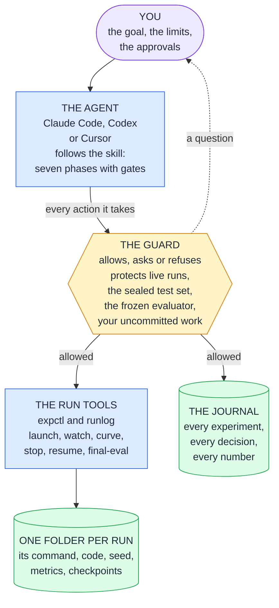
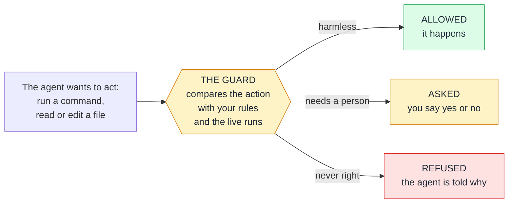
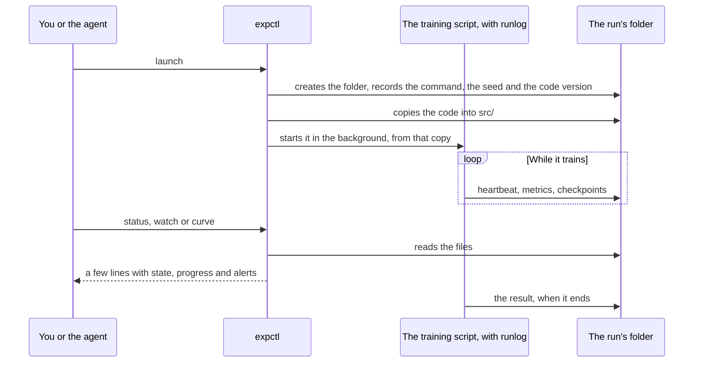
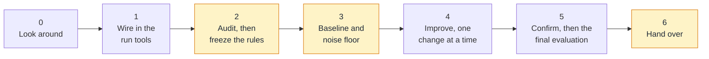

# The nn-training harness: a guide for the person who uses it

> One command installs it · Python 3.8 or newer, standard library only · Claude Code, Codex and Cursor ·
> tested on Windows and WSL2

You have a machine-learning repository and an AI coding agent: Claude Code, Codex or Cursor. The agent can write
training code and run it. What it cannot do by itself is be trusted with your GPU for a night. Left alone, an
agent may stop the wrong job, read the test set, change the evaluation until the number looks better, or report
the luckiest of several runs as progress.

**This kit makes that work safe to leave alone and its results safe to believe.** It is a small set of files
that you install into your repository: a procedure the agent follows, a guard that checks every action the
agent takes, tools that start and record every training run in the same way, and a journal that remembers.

This guide is for the person who uses the kit, not for the agent. It assumes no knowledge of the kit, and the
words it uses are explained in [Words used](#words-used).

| If you want to know | Read |
|---|---|
| What the kit is and how it works, step by step | [Part 1](#part-1-what-the-kit-is-and-what-it-changes), fifteen minutes |
| How it improves training, and what was measured | In Part 1: [How it improves your training](#how-it-improves-your-training) and [What was measured](#what-was-measured) |
| How to try it in ten minutes, with nothing of yours at risk | [Scenario A](#a-try-it-first-on-the-practice-project) |
| How to install it and work with it | [Part 2](#part-2-using-it): sections 1 to 5 |
| A command, a limit or a word | [Part 3](#part-3-reference): sections 6 and 7, the word list |
| How to get the best model: data, starting model, tool stack | [TRAINING_GUIDE.md](TRAINING_GUIDE.md), the companion to this guide |

<sub>Checked: 2026-11-13, against the kit as it stands in this repository. Refresh: when `README.md` or a file
under `.claude/skills/nn-training/references/` changes, re-read the section here that names it. Tool versions
quoted here come from those references and age in weeks. The measurements in Part 1 come from
`docs/upgrade/REPORT.md`.</sub>

## Part 1: What the kit is and what it changes

### The kit in one minute
- **What it is.** Plain files in your repository, most of them under `.claude/`, written with nothing but
  Python's standard library. No service to run, no account, no network. One command installs it and one removes
  it.
- **What it does.** It gives the agent a procedure for training work, checks each of the agent's actions against
  your rules before it happens, starts every training run in the same recorded way, and keeps a journal of every
  experiment and decision.
- **What you do.** You state the goal and the limits, approve a handful of steps (stopping a run, the final
  evaluation, anything that costs money) and read three reports.
- **What it is not.** It is no trainer and no AutoML service. It trains nothing by itself and works beside
  PyTorch, Transformers or whatever your repository already uses.

### The picture

Read it from the top. You give the goal and the limits. The agent does the work, by a written procedure. Each
thing it does passes the guard first, which lets it through, asks you, or refuses. Training goes through one
tool, so every run leaves the same complete record, and every decision goes into the journal.

Not in the picture:
- two read-only helper agents: `experiment-reviewer` doubts every claimed improvement, and `run-analyst` reads
  raw logs so that the main session does not have to;
- two optional modules that stay off until you configure them: `nnloop`, an unattended research loop, and
  `nnremote`, for runs on remote or rented GPUs.

### How it works, step by step
The kit is no program that runs beside your work. It is files that three parties use: the agent reads the
procedure, the agent's own software runs the hooks, and you and the agent call the run tools. This section
follows a project from the installation to its final result.

#### Step 1: The installer puts the pieces into your repository
`install.py` writes these files, all of them inside your repository:

| Piece | Where it lies | What it is for |
|---|---|---|
| The procedure, called the skill | `.claude/skills/nn-training/SKILL.md`, with fifteen references | Tells the agent how training work is done here: seven phases, a gate after each |
| The guard and the status hook | `.claude/hooks/` | Small programs that the agent's software runs by itself: the guard before every action, the status hook when a session starts |
| The run tools | `expctl.py` and `runlog.py` under `.claude/skills/nn-training/scripts/` | Start, watch, stop and continue training runs, each recorded in the same way |
| Your rules | `.claude/nn-training.json` | Which metric decides, which data is sealed, which files are frozen, how the final evaluation is run |
| The journal | `experiments/JOURNAL.md` | The project's memory: every experiment, every decision, every number |
| Eleven standing rules | a marked block in `CLAUDE.md` or `AGENTS.md` | What the agent must keep in mind all session long, also after a long conversation was shortened |
| Two helper agents | `.claude/agents/` | A sceptical reviewer and a log analyst, both read-only |

The installer also registers the hooks in the agent's settings (for Claude Code `.claude/settings.json`, merged
with what is there). `--dry-run` shows every change first, and `--uninstall` takes the kit out again.

#### Step 2: A session starts, and the agent knows where things stand
When you start the agent in the repository, its software loads the hooks. The status hook puts a short, current
status into the session: which runs are alive, which have ended, what needs attention. It does so again when a
session is resumed and after a long conversation was compacted, so the agent never acts on a stale memory of
which runs are alive. The eleven rules are part of the agent's instructions from the first message, and the
skill is loaded as soon as your request touches training.

#### Step 3: Every action passes the guard

Before the agent runs a command, reads a file or edits one, its software hands that action to the guard. The
guard is an ordinary program, not an AI. It compares the action with your rules and with the list of live runs,
and gives one of three answers:

| The agent tries to | The guard's answer |
|---|---|
| read or search the training code | Allowed |
| read a file of the sealed test set | Refused |
| edit a file inside the folder of a run that is still training | Refused |
| edit the evaluator or another frozen file | You are asked |
| stop or kill a run, or delete a run's folder or a checkpoint | You are asked |
| run `git reset --hard` or `git push` | You are asked |
| install or update a package while a run is live | You are asked |
| start the final evaluation, or compute that costs money | You are asked |

Every refusal and every question goes into a log (`.claude/state/guard.log`: commands and paths, never the
content of a file). When the guard refuses, the agent is told why, and its instructions are to explain to you
what it wanted and not to look for a way around. With Codex and Cursor a hook cannot ask a person, so each "you
are asked" above is a refusal there, and the agent hands you the command to run yourself.

#### Step 4: A training run leaves a complete record
The agent does not start training with a bare `python train.py`. It uses one command, and so can you:
```bash
python3 .claude/skills/nn-training/scripts/expctl.py launch --name first-try --seed 1 -- python train.py --seed 1
```

What that command sets in motion:
1. **A folder of its own.** `expctl` creates `runs/<id>/`. The id is made of the date, the time and the name you
   gave, for example `20261113-162239-first-try-65ad`.
2. **Where the run came from.** The command, the seed, the git commit, any uncommitted changes and a hash of the
   source are written to `manifest.json`.
3. **Its own copy of the code.** By default the run works from a snapshot of the source under `runs/<id>/src`,
   so an edit made later cannot change a run that is under way. Sealed test data is left out of the snapshot,
   and a file named like a credential (`.env`, `*.key`) is linked into it, not copied.
4. **In the background.** The run is started detached, so nobody has to wait for it. For a run of more than
   about an hour on Linux or WSL the agent adds `--via tmux`, so that the run outlives the session.
5. **A pulse and the numbers.** A few lines of `runlog.py` in your training script write a heartbeat, every
   metric you log and each checkpoint. Phase 1 of the procedure wires them in.
6. **Watching costs little.** `status`, `watch` and `curve` read those files and answer in a few lines. A run
   whose heartbeat stops is reported as stalled, and a failure, non-finite values, a passed deadline or a disk
   that fills up raise an alert.
7. **A stop is a request.** `expctl stop` asks the run to save a checkpoint and end, and only after a grace
   period is it killed. `expctl resume` starts a new run that continues from that checkpoint.
8. **The end is on record.** `result.json` holds the final state and values, `exit.json` the exit code.

| In `runs/<id>/` | What it holds |
|---|---|
| `manifest.json` | The command, the seed, the git commit and uncommitted changes, the source hash, the deadline |
| `src/` | The snapshot of the code that the run executes |
| `stdout.log` | Everything the script printed |
| `heartbeat.json` | The run's pulse: the latest step and values, the best and the last checkpoint |
| `metrics.jsonl` | Every logged metric, one line per entry |
| `config.json`, `env.json` | The run's settings; the interpreter, the framework and the device |
| `result.json`, `exit.json` | The final state and values; the exit code |

So a number can be traced back, months later, to the code, the command and the seed that produced it.

#### Step 5: The agent works in seven phases and stops at each gate

A phase is a step of the procedure. A gate is the check at its end: it must pass before the next phase starts,
and its outcome goes into the journal. The order is the point. The rules of comparison are frozen (Phase 2) and
the noise is measured (Phase 3) before anything is improved (Phase 4), and the test set is used once, at the very
end (Phase 5). You get a report after each of the three highlighted phases.
[Section 3](#3-what-the-agent-does-and-what-you-decide) has the table of what happens in each phase and what you
do.

#### Step 6: A result counts only when it beats the noise
An example with made-up numbers. The baseline is trained three times, with three random seeds, and reaches a
validation loss of 1.70, 1.72 and 1.69 (lower is better). The code and the data were the same each time, so the
differences are luck. The mean is 1.703, and the three values scatter around it by about 0.015 (their standard
deviation). That scatter is the **noise floor**.

| A change scores | How it is read |
|---|---|
| 1.69 on one seed | Inside the noise: the untouched baseline scored 1.69 as well. Nothing was shown |
| 1.69, 1.70 and 1.70 on the same three seeds | 0.007 better on average, less than half the scatter. Not a gain |
| 1.65, 1.66 and 1.64 on the same three seeds | 0.053 better, about three and a half times the scatter. A candidate |
| 1.65, 1.67 and 1.66 again, on three seeds that nobody used before | Confirmed. Now it may be reported |

In the agent's own work this rule is part of the procedure, and the reviewer agent checks it before an
improvement is claimed. In the unattended loop a program applies it: with three seeds, a first change is kept
only when it gains 2.3 times the run-to-run deviation (scenario G).

#### Step 7: The test set is used once, at the end
Every number so far came from validation data. The test set stayed sealed: the guard refused each attempt to
read it. Once the final procedure is written into the journal (configuration, seeds, training length, which
checkpoint), one command runs the final evaluation:
```bash
python3 .claude/skills/nn-training/scripts/expctl.py final-eval -- ARGS
```
The guard asks you first. `expctl` writes a receipt before the command starts and an entry into the journal, and
it refuses a second use unless a reason is given, which is recorded too. A test set that is looked at twice is
no longer a test set (scenario J).

#### The same steps without you: the two optional modules
Both stay off until you configure them. `nnloop` repeats Steps 4 and 6 unattended: an agent session proposes one
change, and harness code trains it, scores it with the frozen evaluator and keeps or reverts it (scenario G has
a picture). `nnremote` runs Step 4 on a machine you reach over ssh or on rented GPUs, under a spending cap
(scenario H).

### What it changes
| Left alone, an agent may | With the kit | Held by |
|---|---|---|
| stop, kill or restart a run that has trained for days | You are asked first. A stop is graceful: the run is told to save a checkpoint and end, and one command continues it later | the guard, the run tools |
| overwrite a live run's files, delete runs or checkpoints | Every run has a folder of its own and, by default, its own snapshot of the code. An edit inside a live run's folder is refused; a deletion is asked about | the guard, the run tools |
| read the test set, or sweep a search across it | Reading sealed data is refused, and a search that would sweep across it is asked about or refused. The final evaluation runs through one command, which keeps a receipt of every use | the guard |
| edit the evaluator, the metric or the splits until the number improves | Those files are frozen: you are asked before any edit | the guard |
| report a lucky run as an improvement | A baseline on several seeds measures the noise first. A change counts only when it beats that noise, and the best result is trained again on fresh seeds | the procedure and the reviewer; in the loop, harness code |
| run `git reset --hard`, push, or change packages under a running study | You are asked first | the guard |
| lose the thread after a long session | The journal holds every experiment, and the live run status is shown at every session start, resume and context compaction | the session hook, the journal |
| fill its context with logs | `status`, `watch` and `curve` answer in a few lines, and a helper agent reads the raw logs | the run tools |
| spend money on compute | You are asked before paid compute starts, and the kit's own remote runs start nothing paid without a spending cap that covers it | the guard, harness code |

"The guard" and "harness code" mean that a program decides, whatever the agent intends: it refuses, or it asks
you. "The procedure" means that the agent is told and a reviewer checks; no program refuses. With Codex and
Cursor a hook cannot ask a person, so what would be a question is refused, and you run that step yourself. The
table "What works where" in [README.md](../README.md) says which is which for every agent and platform.

### How it improves your training
A training project gets better in two ways: the model scores higher, or the score you have becomes one you can
rely on. The kit works on both, and it is strongest on the second.

**1. You can believe the number.** Train the same code twice with two random seeds, and the two scores differ.
A change that does nothing therefore "wins" a single comparison about half of the time. That is one classic
source of false progress. The other is a test set that was looked at too often. The kit works against both:
- The test data is **sealed**: the guard refuses the agent's attempts to read it. The evaluator is **frozen**:
  the agent cannot edit it without your approval.
- Before anything is improved, a baseline is trained on several seeds. The spread between them, the **noise
  floor**, is written down, and a later gain smaller than it does not count as a gain.
- The best configurations are trained again on **fresh seeds** before anyone believes them.
- The **final evaluation** on the test set runs through one command, which asks you first and keeps a receipt
  of every use.
- A sceptical **reviewer** agent checks a claimed improvement before it is reported.

**2. Nothing gets lost.** A run that has trained for two days cannot be redone for free, and the guard treats
it that way: stopping, killing and deleting need your word. A stop first tells the run to save a checkpoint and
end by itself, and one command continues an ended run from its checkpoint. Every run keeps the command, the
code, the seed and the environment it was started with, so a result can be traced back to what produced it,
months later.

**3. A method takes the place of guessing.** The agent works through seven phases and may not skip a gate: look
first, wire in the logging, audit the data and freeze the rules of comparison, train a strong baseline, then
improve it with one stated hypothesis per change, compared at equal budget on the same seeds. Settings that are
only numbers go to a search tool and not to the agent's hunches. None of this is new: it is what careful
practitioners do. The kit's part is that the agent gets it in writing, stops at every gate and writes down every
step.

**4. Your time goes further.** You read three reports and answer a few questions. One command shows what is
running, what has finished and what needs attention: a stalled run, a failure, non-finite values, a disk that
fills up. After a week away, the journal and the status put you and a fresh agent session back where the work
stopped.

**5. Improvement while you are away** (optional). For runs that take seconds to minutes, the loop `nnloop` lets
the agent try one change after another, unattended. Harness code, not the agent, scores each change with the
frozen evaluator on several seeds, keeps it only when it beats the noise, and at the end confirms what it kept
on seeds that nobody has seen. It stops at the first limit you set: runs, hours, GPU-hours, money or tokens.

**6. More GPU when it pays** (optional). `nnremote` runs the same commands on a machine you reach over ssh or on
rented GPUs, under a spending cap, and continues a run from its last checkpoint after a preemption. The ssh
route ran live once; the rented route is tested against a stand-in only (scenario H).

### What was measured
The kit applies its own rule to itself: a claim needs a measurement. These are the measurements of November
2026, on one machine with one GPU; where an agent took part, it was Claude Code.
[REPORT.md](upgrade/REPORT.md) has the method and the detail of each.

| Question | How it was measured | Result |
|---|---|---|
| Does an agent with the kit reach a better score than the same agent without it, on a short task? | Five agent sessions per arm on a small language-model benchmark, each allowed at most 12 training runs of 30 seconds | **No.** Test loss, lower is better: 1.7501 with the kit, 1.7425 without it, 1.7568 for the training script that nobody touched. The differences between the arms lie inside the run-to-run noise |
| Does the unattended loop find gains that are real? | A campaign with a real agent on the same benchmark, 12 November: eleven changes trained | **Yes, in this campaign.** Two changes were kept. Trained again on fresh seeds, the validation loss went from 1.6948 to 1.6407: a gain of 0.054 against a noise margin of 0.013 |
| And the two campaigns before the loop's keep rule was made stricter? | Five and six proposed changes | One change kept in each, with validation gains of 0.013 and 0.009, above the margin. On the test split both results were about 0.009 better than the untouched script, which is close to the noise there |
| How often does the loop keep a change that does nothing? | A simulation of its keep rule | In 2.1 to 2.3 % of comparisons. The price: a real gain of two run-to-run deviations is kept in about 60 % of them at a campaign's first change, and in about 80 % once several seed panels are behind its noise estimate |
| Does a search of the numeric settings by the harness help? | Three pairs of campaigns on each of two tasks, with a scripted stand-in for the agent and real training, 13 November | **On one task of the two.** Fine-tuning: a confirmed gain in accuracy of 0.42 with the search against 0.31 without it, and two of the three pairs carry that difference. Character model: nothing was kept either way. So the search is off unless you turn it on |
| Does the guard hold? | Seven test files on Windows and WSL2, independent reviews in every round of work, headless agent sessions on Windows | The reviews found holes in every round, and each finding was fixed or answered. What the guard still does not catch is listed in [README.md](../README.md), "Notes and limits" |

**How to read this.** The first row is the honest ceiling: the kit does not make an agent cleverer, and on a
task with six minutes of training it bought no better score. Five sessions per arm can only show a difference of
about 1 %, so "not shown" is not "equal", and it is one task, one machine and one model. The rows below it are
what the kit is for: in the campaign of 12 November, what the loop kept was still better on seeds that nobody
had seen. That too is one campaign on one task. Expect the kit to pay off as trust and protection on work that
runs for hours or days, not as a better number on a short task.

### What it does not do
- **It trains nothing by itself.** Use it together with a trainer library (PyTorch; Transformers, TRL and PEFT
  for language models) and, for numeric settings, a search tool (Optuna). It replaces neither.
- **It does not choose your data or your starting model.** The best results come from four things, in this
  order: a measurement you can trust, better data, a better starting model, and then a disciplined search. A
  cleverer loop comes after all four. [TRAINING_GUIDE.md](TRAINING_GUIDE.md) is about them.
- **The guard is a seatbelt, not a sandbox.** It stops the mistakes an agent makes in the open. A program that
  builds a file path while it runs can still get past it, and git can print a sealed file that it tracks. For
  hard isolation keep the test split outside the repository, and out of git in any case.
- **It binds only the sessions it runs in.** Start the agent at the project root. Claude Code sessions started in
  another checkout of the repository need one more installer option, `--worktrees`; with Codex and Cursor such
  sessions are unguarded.
- **Codex and Cursor are less proven than Claude Code.** Their ports are built from the vendors' documentation
  and tested against documented payloads. No live session of either ran here.

## Part 2: Using it

In a hurry? Scenario A gives you a working practice project in ten minutes, with nothing of yours at risk.
Section 2 installs the kit into your own repository.

### 1. Which tool for which job
| You want to | Use | Why, and the catch |
|---|---|---|
| Have an agent train carefully in your own repository, any kind of model | this kit with the framework the repository already uses | The standard path (scenario B) |
| Fine-tune an open language model on your data | this kit with Transformers, TRL and PEFT (bitsandbytes when the model needs 4-bit loading) | Scenario D. Unsloth is another trainer for one GPU: a candidate, its speed figures are the vendor's and were not measured here, and it caps Transformers and TRL at older versions |
| Improve a small GPT's training recipe overnight, on one GPU, on the task autoresearch ships | `karpathy/autoresearch` as it is; on native Windows with an RTX card the fork `jsegov/autoresearch-win-rtx` | The simplest route for exactly that task. It keeps a change on the score of a single run, so some kept "improvements" are noise, nothing in it is enforced, and its README advises running the agent with permissions off: do that only in a container without your credentials. Neither was run here, and the fork's author has not tested its claims for the newest cards |
| The same keep-or-revert pattern on your own task, with decisions you can believe | this kit's loop, `nnloop` | Scenario G. The harness scores every run itself, on several seeds, with a noise margin and a confirmation on fresh seeds. A decision costs three runs instead of one, and fewer changes are kept |
| Search numeric settings (learning rate, weight decay, batch size) | Optuna, driven by the agent under the kit | Scenario F |
| Train on more GPU than you own | this kit's remote module, `nnremote` | Scenario H. The ssh route ran live once; the Hugging Face Jobs route has not run against the real service |
| Run the coding agent itself on a local model (`unsloth start` and similar) | not while you train on the same GPU | The agent's model then competes with training for the card, and a weaker agent decides worse. A second GPU would change this |

Questions that come up:
- **"This kit with autoresearch?"** Not both loops on one repository: each would commit, revert and score on its
  own. The kit's loop is the autoresearch pattern, rebuilt so that harness code decides. What does combine is
  the content: the scouting step may take settings from autoresearch and its forks as hypotheses to test. Running
  the kit's loop on autoresearch's own task would need its scoring split into a separate evaluator script that
  reads what a run saved; that was not tried.
- **"Autoresearch instead?"** Yes when its task is your task and you want the least setup. No when the task is
  your own, when you need to trust each kept change, or when the agent must not run with permissions off on
  your machine.
- **"Another plugin that drives the loop from inside the agent session?"** The ones reviewed
  (`davebcn87/pi-autoresearch`, `marcelopazzo/claude-code-autoresearch`) leave the agent in charge of its own
  measurement; the second also showed destructive git behaviour. Both are rejected in the ledger; ideas from
  the first (a noise floor from repeated baselines, a stop after repeated failures) are built into `nnloop`.
- **"On a Mac?"** `trevin-creator/autoresearch-mlx` is the only macOS-native version of that task that was found;
  it was not tried with the kit. `miolini/autoresearch-macos` has no licence and no activity: leave it. The kit
  itself is expected to work on macOS and was not run there.
- The decision on every project that was looked at, with its reason and date, is in `docs/upgrade/LEDGER.md`.

### 2. Set up once
```bash
python3 install.py --target /path/to/your/repo --dry-run
```
```bash
python3 install.py --target /path/to/your/repo
```
The first command only shows what the second would write. On native Windows call it with `python`. Add
`--agents all` for Codex and Cursor, `--mcp` for the two MCP servers (Context7 for library documentation, the
Hugging Face hub), `--statusline` for the Claude Code status line. The installer writes only inside the target
project. Then:
1. Restart the agent in the repository so that the hooks load.
2. Run the self-test: `python3 .claude/skills/nn-training/scripts/expctl.py selftest`. Every required check must
   pass.
3. In Claude Code set a high effort level for the main session, on the strongest model you have: that session
   makes the design decisions. (The sessions of an unattended campaign are the opposite case, scenario G.)
4. Fill in the Project card at the top of `KICKOFF_PROMPT.md` (it lies in the kit's folder) and paste the whole
   prompt into the agent.

Ten minutes before the first session that pay back many times:
- **Say what "better" means**: the one metric that decides, and what you would trade for it (training time,
  memory, model size).
- **Say what may be spent**: which GPUs, how many GPU-hours, by when; paid compute and unattended campaigns are
  off unless you allow them with limits.
- **Set the test data apart**: its own file or folder, so that it can be sealed. Outside the repository is
  stronger still, because the guard is a seatbelt and not a sandbox.

### 3. What the agent does, and what you decide
The agent follows the phases of the skill and stops at each gate. You get a report after Phase 2, after Phase 3
and at the end.

| Phase | What happens | What you do |
|---|---|---|
| 0 Reconnaissance | Reads the repository, finds live jobs, fills the Project card in `experiments/JOURNAL.md` | Answer its one batch of questions |
| 1 Harness integration | Wires `runlog.py` into your training script; a small smoke run through `expctl launch` | Nothing, unless it asks to stop the smoke run |
| 2 Validity audit, protocol freeze | Checks splits for leakage, runs the sanity gate, proposes the metric, the sealed and frozen paths and the final-evaluation command | Approve the config edits (the guard asks) |
| 3 Baseline and noise floor | Trains the strongest affordable baseline on several seeds; measures the spread between seeds and the cost of a run; estimates the campaign | Authorise a budget |
| 4 Improvement loop | Scouting notes with sources, then one hypothesis per change, each compared at equal budget against the baseline; numeric search for the settings that are only numbers | Approve stops, deletions and dependency changes when asked; optionally allow an unattended campaign |
| 5 Confirmation, final evaluation | Re-runs the best configurations on fresh seeds, freezes the final procedure, runs the final evaluation once | Approve the final evaluation |
| 6 Handoff | Final report, exact commands, next experiments | Read it |

The guard asks you before: stopping or killing a run, deleting runs or checkpoints, destructive git, a push,
edits of frozen or harness files, the final evaluation, dependency changes while runs are live, paid compute,
and starting a campaign or a remote run. It refuses outright: reading sealed test data, the final-evaluation
command typed directly, and file edits inside a live run's folder. With Codex and Cursor a hook cannot ask, so what
would be a question is refused and the agent gives you the command to run yourself.

### 4. Scenarios

#### A. Try it first on the practice project
```bash
python benchmarks/new_project.py ../charlm-try
```
Run this in the kit's folder. It creates the practice project in a new folder beside it (any other path works
as well): a small git project, a character-level language model that trains in 30 seconds, with the kit
installed, two sealed splits, a frozen evaluator and a ready `loop` section. It needs PyTorch in the interpreter
you call it with, and it touches nothing of yours. Where the interpreter is called `python3`, use that name in
every command of this scenario. Three things to try in the new folder, from the smallest to the largest.

**The run tools, by hand** (two minutes, no agent). Check the wiring, start a run, wait for it, read its curve:
```bash
python .claude/skills/nn-training/scripts/expctl.py selftest
```
```bash
python .claude/skills/nn-training/scripts/expctl.py launch --name first-try --seed 1 -- python train.py --seed 1 --time-budget 30
```
```bash
python .claude/skills/nn-training/scripts/expctl.py watch all --until terminal
```
```bash
python .claude/skills/nn-training/scripts/expctl.py curve first-try --keys train/loss,dev/loss
```
The self-test prints one JSON object, and `"ok": true` at its top says that every required check passed. One
optional item is reported as not ok there: the practice project keeps its two sealed text files in git, and the
self-test points that out. `watch` prints one line per event and ends when the run does:
```text
{"event":"state","run":"20261113-162239-first-try-65ad","from":"starting","to":"running", ...}
{"event":"metric","run":"20261113-162239-first-try-65ad","step":4500,"metric":"dev/loss","value":1.4211810052394866, ...}
{"event":"state","run":"20261113-162239-first-try-65ad","from":"running","to":"completed", ...}
{"event":"done","reason":"all watched runs are terminal", ...}
```
These are four of the lines of a run on the test machine (13 November 2026), shortened where the dots are. Its
validation loss fell from 2.44 at step 250 to 1.40 at step 5,296. The run's folder under `runs/` now holds the
command, a copy of the code, the seed, the metrics and the trained model, and `expctl.py status --brief` lists
the run as the best one so far (a line that begins with `TOP`).

**A session with the agent.** Start the agent in the new folder, fill in the Project card of `KICKOFF_PROMPT.md`
and paste the prompt (section 2). Every training run there takes 30 seconds.

**An unattended campaign:**
```bash
python .claude/skills/nn-training/scripts/nnloop.py start --campaign first --agent claude --max-runs 40 --max-hours 2
```
The agent sessions of a campaign draw on your subscription. Without `--max-usd` the loop stops as soon as Claude
Code reports that usage would be billed per use. Scenario G says what a campaign does and how to read its result.

A second practice project fine-tunes a small chat model with a LoRA adapter instead: run
`python benchmarks/finetune/fetch_model.py` once (270 MB), then
`python benchmarks/new_project.py DIR --task finetune`. It needs PyTorch, Transformers and PEFT in the interpreter
you call it with (`benchmarks/finetune/README.md`).

#### B. An existing training repository
1. Install, restart the agent, run the self-test (section 2).
2. Fill the Project card. Name the live jobs the agent may touch; the default is none.
3. Paste the kickoff prompt and let Phases 0 to 3 finish before you ask for improvements. The seed-to-seed
   spread measured in Phase 3 is what later tells a real gain from a lucky run.
4. Keep the framework, the environment manager and the tracker you have. The kit's rule is one tracker and one
   sweep controller, and a new component only for a stated benefit.

#### C. A new project from an idea and some data
The kit does not scaffold a project. Do this first, then continue as in B:
1. `git init` a repository; put the data in, with the test split set apart.
2. Create the environment with a lock file (`uv` with a committed `uv.lock` is the recommended manager).
3. Install the kit and say in the Project card what you want, and that there is no training code yet.
4. Ask for the simplest baseline first. Phase 3 wants "the strongest affordable baseline", tuned learning rate at
   the least, before anything clever.
[TRAINING_GUIDE.md](TRAINING_GUIDE.md) helps you decide what kind of training the idea needs.

#### D. Fine-tune an open language model on your data
The agent loads `references/finetuning.md` and `references/llm.md` for this. What a good run of it looks like:
1. **Evaluator and baseline rows first**: the untuned model with a fixed prompt, and a trivial predictor, both
   scored by the frozen evaluator. The task metric decides; loss is logged.
2. **Base model**: the deployment target and the licence limits fix the candidates. Two or three sizes are
   evaluated unchanged before any training. An unclear, non-commercial or gated licence is a question for you.
3. **One training framework per environment**, pinned (they pin each other): Transformers 5.22.2, TRL 1.17.1,
   PEFT 0.21.2, bitsandbytes 0.50.2 were the versions of 11 November 2026.
4. **Template check before any long run**: three training examples rendered and tokenised exactly as the trainer
   does it, and read. Most silent failures of fine-tuning live here (a doubled start token, a missing end token,
   loss on the wrong tokens).
5. **Memory fit by trying, not by formula**: one training step on the longest sequence at the real batch size.
6. **Start with LoRA** on all linear layers and sweep the learning rate; load the base in 4 bits (QLoRA) only
   when 16 bits do not fit; go to full fine-tuning when the data outgrows the adapter. The run records the
   count of trainable parameters and fails when it is zero.
7. **Compare on seeds, confirm, evaluate once** (scenario J), and score the exported file again: a merged,
   quantised or converted model is a new model.

A Project card for this case:
```text
- Goal: answers to support tickets in our house style; quality first, the model must run on one 24 GB card
- Primary metric and direction: exact-match on data/val.jsonl, higher is better
- Compute you may use now: the local GPU, 20 GPU-hours, by Friday
- Paid or cloud spend allowed: none
- Unattended campaign allowed: none
- Hard constraints: licence must allow commercial use; no data leaves this machine
```
On native Windows two parts of this stack were not re-checked or are missing: bitsandbytes (status not
re-checked) and vLLM (no native Windows support; RL post-training with fast rollouts needs WSL2).

#### E. A small model from scratch
Useful as a research benchmark or as a small model for one domain; one GPU does not produce a general assistant
this way. Give every experiment the same wall-clock budget, keep data, tokenizer and evaluation in files the
agent may not edit, and let it edit the training file. That is scenario G on your own script, or autoresearch on
its own task (section 1). A fixed budget favours changes that are fast, not changes that are best at
convergence: test what the loop kept at the real budget before you merge it.

#### F. Searching numeric settings
The kickoff prompt's rule is "tune with numbers, think with words". For settings that are only numbers the agent
uses the sweep controller the project has, or Optuna (5.0.0 on 11 November 2026) when there is none, and lets the
sampler choose the values; its own guesses may enter as a minority of the trials. The learning rate comes first.
The best trial of a search is biased upward, so the top three configurations are trained again on fresh seeds and
the decision comes from those runs; the budget for that is set aside before the search starts. The study's
storage goes into the config (`optuna.storage`, for example `sqlite:///experiments/optuna.db`), `expctl status`
then lists the studies, and `RunLog.for_trial(trial)` ties each trial to a run directory. `references/hpo.md` has
the samplers, pruners and budgets.

#### G. An unattended campaign with `nnloop`
For cheap runs, seconds to minutes each, after Phases 0 to 3: the protocol is frozen and you trust the evaluator.
The project must be a git repository with the kit's files committed. What a campaign does, in one picture:


1. Add a `loop` section to `.claude/nn-training.json` (the agent may propose it; the guard asks you). The
   practice project's section, which is tested:
```json
"loop": {
  "task": "Lower the held-out loss of the model that train.py trains ... A run must save model.ts ...",
  "train_command": ["{python}", "train.py", "--seed", "{seed}", "--time-budget", "30"],
  "eval_command": ["{python}", "evaluate.py", "--data", "data/loopval.txt", "--run-dir", "{run_dir}"],
  "direction": "minimize",
  "seeds": [1, 2, 3],
  "run_budget_s": 90,
  "editable_paths": ["train.py"],
  "min_margin": 0.005
}
```
   The evaluator must be a frozen file, read a validation split and print a last JSON line with a finite
   `score`. If the split it scores on is listed in `sealed_paths`, the agent cannot see the data that decides.
2. Start it, with at least one limit:
```bash
python3 .claude/skills/nn-training/scripts/nnloop.py start --campaign NAME --agent claude --max-runs 60 --max-hours 8 --detach
```
```bash
python3 .claude/skills/nn-training/scripts/nnloop.py status --campaign NAME
```
```bash
python3 .claude/skills/nn-training/scripts/nnloop.py stop --campaign NAME
```
3. What it does: a baseline on every seed and a self-test of the evaluator, one scouting session, then
   iterations. Each iteration is a fresh agent session that makes one change in a fresh worktree; the harness
   trains it, scores it with the frozen evaluator and keeps or reverts. When the campaign ends and something
   was kept, the start and the kept version are trained on seeds nobody has seen.
4. Read the result in `nnloop status` and in the journal entry. Claim the gain the confirmation measured, not the
   best score of the iterations:

| Verdict | What to do |
|---|---|
| `confirmed` | Have the reviewer read the kept diffs, test at the real budget, then go to scenario J |
| `unclear` | Run both versions on more seeds before relying on it |
| `not_reproduced` | Treat the change as noise |
| `not_run`, `unfinished`, `failed` | `nnloop resume` with limits that cover the confirmation |

   Kept code sits on the branch `nnloop/NAME`; nothing is merged for you.

Settings that matter:
- **Three seeds or more.** With three, the first change must gain 2.3 run-to-run deviations to be kept; with two,
  4.5. A gain that just misses (above two thirds of the margin) is trained on a second seed panel and decided on
  all seeds. In simulation a change without effect is kept in about 2.7 % of comparisons and a real gain of two
  deviations in about two thirds.
- **A run limit well above five seed panels** (15 runs with three seeds), because the confirmation holds back
  two panels once something is kept, and a near-miss costs up to two more.
- **A mid-tier model and moderate effort for the iteration sessions** (`--model`, `--effort`). Each session makes
  one small edit.
- **`loop.search_trials`** (optional, off unless set): a change may then hand its numbers to the harness, which
  trains up to that many versions on one seed outside the panels and puts the best one through the same keep
  rule (`references/loop.md`, "A search by the harness"). Every version is a run that counts against the run
  limit, and until the first keep nothing is held back for the confirmation: leave room in the run limit.
  Measured on 13 November 2026 on the kit's two benchmark tasks with a stand-in agent, three pairs of campaigns
  each at 18 runs: on the fine-tuning task the confirmed gain was 0.11 accuracy higher on average with the
  search, on the character model nothing was kept either way, because its starting values were already good.
  Set it where a task's numbers have not been tuned. Not measured with a real agent.
- **`loop.restart_after`** (optional, off unless set): a campaign that keeps nothing for that many iterations in a
  row goes back to the commit before its last keep and looks in another direction; it ends on the best commit it
  found, and that one is confirmed (`references/loop.md`, "A restart when the campaign stalls"). Tested with a
  stand-in agent; whether it raises results has not been measured.
- **Leave the project folder alone while a campaign runs**: a changed file stops it.
- On Linux and WSL2 with bubblewrap a run has no network and sees the project read-only. On native Windows and
  macOS those two are not enforced: a changed protected file is caught at the next checksum, a change to an
  installed package that the evaluator imports is not. The loop ran live with Claude Code on native Windows only;
  on Linux it is tested with a stand-in agent.

#### H. More GPU than you own, with `nnremote`
Add a `remote` section to `.claude/nn-training.json` with a spending cap and one or more targets; then a remote
run obeys the same commands as a local one.
```bash
python3 .claude/skills/nn-training/scripts/nnremote.py launch --name NAME --on TARGET --hours 2 --seed 1 -- {python} train.py --seed 1
```
- **A machine you can reach over ssh** (`"type": "ssh"`): free unless you give it a price. The remote side needs
  a POSIX shell and Python 3.8 or newer. Put a shutdown timer on a rented machine yourself.
- **Hugging Face Jobs** (`"type": "hfjobs"`): rented by the hour. You install its CLI, sign in and create a
  private bucket; the kit never signs in or stores a token. This route is tested against a stand-in only: run
  the ten-cent canary at the end of `references/remote.md` before you trust it with money.
- Nothing paid starts without a `cap_usd` that covers it; hours times price are reserved first, and a job cannot
  outlive its hours.
- A remote run receives the tracked source, the files you name and the environment variables you name. Sealed
  data, `.env` files and your shell's environment stay at home. The final evaluation never runs remotely.
- A training script survives preemption when it saves into the run directory and continues from
  `rl.resume_from`; `--retries K` then restarts it from the mirrored checkpoint.

#### I. A run goes wrong
- `expctl status --brief` lists alerts: a stalled run, a run past its deadline, a failure, non-finite values, a
  seed that differs from the one launched, a GPU shared by several runs, low disk. An alert is an observation;
  stopping a run still needs your approval.
- Ask for a diagnosis with one precise question ("why did run X diverge at step 12k?"). The agent hands the raw
  logs to its `run-analyst` subagent, which keeps them out of the main context.
- `expctl resume RUN` continues an ended run from its checkpoint as a new run. It refuses when the code has
  changed since that run was launched, unless you pass `--allow-code-change`.
- On native Windows a graceful stop is a `stop.json` file only: a training loop that does not poll
  `rl.should_stop()` is killed after the grace period.

#### J. Finishing: the one final evaluation
A test set that is looked at twice is no longer a test set. The final procedure (configuration, seeds, training
length, checkpoint rule) is frozen in the journal first. Then:
```bash
python3 .claude/skills/nn-training/scripts/expctl.py final-eval -- ARGS
```
The guard asks you; the configured command typed directly is refused. Every use leaves a receipt and a journal
entry. With several `final_eval_commands` entries, `--which N` names one (counted from 1). Any further use, of
the same entry or another, needs `--again "reason"`, and the report states every use.

#### K. Long projects, and coming back later
`experiments/JOURNAL.md` is the project's memory; a hook shows the live run status at every session start,
resume and compaction. Start a new session with "read the journal and `expctl status --brief`, then continue".
For runs longer than about an hour on Linux or WSL the agent launches with `--via tmux`, so that the run
survives the session; on native Windows runs are detached processes.

#### L. Codex or Cursor instead of Claude Code
Install with `--agents codex`, `--agents cursor` or `--agents all`. The procedure is the same; these differ:
- Their hooks cannot ask a person, so every step that needs you is refused and handed to you as a command.
- Codex: trust the project and approve the two hooks once in `/hooks`; if a hook does not load, Codex runs
  without it. On native Windows start Codex from the project root.
- Cursor's terminal agent can run the loop only with `--in-container`.
- Neither port ran in a live session here; they are built from the vendors' documentation and tested against
  documented payloads. The table "What works where" in `README.md` has every difference.

#### M. Upgrading and removing
Run the new `install.py` over the old install with the same command: it keeps the config values, the journal,
the runs and your settings, and backs up every kit file it replaces under `.claude/backups/`. Remove with
`install.py --target DIR --uninstall`: config, journal, runs and backups stay.

### 5. Habits that get the most out of it
- **Give the limits up front** (compute, money, unattended or not). The agent then asks once instead of
  stopping at every step.
- **Do not ask it to work around the guard.** If a rule is wrong for your project, change the config; the guard
  asks you for that edit.
- **Read the three reports.** They carry the protocol, the baseline with its spread, and every number with the
  run it came from.
- **Believe the confirmed gain**, not the best score of a search: the best of many tries on one validation
  split is biased upward.
- **Change one thing at a time**, at equal budget, on the same seeds.
- **No dependency changes while runs are live**, and no second tracker or sweep tool beside the one in use.
- **Treat what the agent reads on the web as data.** Scouting notes are hypotheses with sources, never defaults.

## Part 3: Reference

### 6. Commands at a glance
`E` stands for `python3 .claude/skills/nn-training/scripts/expctl.py`, run from the project root.

| Need | Command |
|---|---|
| What is running, best runs, alerts | `E status --brief` |
| Start a run | `E launch --name lr3e-4 --seed 1 --note "hypothesis" -- python train.py --lr 3e-4 --seed 1` |
| Wait for it | `E watch RUN --until terminal` |
| Its curves | `E curve RUN --keys train/loss,val/acc` |
| Stop it gracefully | `E stop RUN --wait 5m` |
| Continue it from its checkpoint | `E resume RUN` |
| Final evaluation, once | `E final-eval -- ARGS` |
| Is the harness wired up | `E selftest` |
| Which fast paths work here (CUDA, bf16, flash attention, fused AdamW, `torch.compile`) | `E env --python PY --probe` |
| Unattended campaign | `nnloop.py start`, `status`, `stop`, `resume` (scenario G) |
| Remote run | `nnremote.py launch`, `status`, `resume`, `attach` (scenario H) |

### 7. Limits to keep in mind
- The guard is a seatbelt, not a sandbox. `README.md`, "Notes and limits", lists what it does not catch.
- Not verified live: Codex and Cursor sessions, the Hugging Face Jobs route, the loop with Claude Code on Linux,
  macOS and bare Linux as platforms.
- The loop's stricter keep rule, its self-test and its confirmation have run with a real agent once, on the
  benchmark (12 November 2026); beyond that they are tested and simulated. In that campaign the first three runs
  understated the noise, so the first keep passed at the configured minimum margin: set `loop.min_margin` from
  what you know about your task's run-to-run noise.
- The recommended PyTorch build (2.15.0 with CUDA 13.2) crashed at its first GPU call on the test machine in
  WSL2; keep the build your project runs until a one-line GPU check passes on the new one
  (`references/stack.md`).

### Words used
The words of training itself (seed, baseline, noise floor, splits, checkpoint, LoRA) are explained in
[TRAINING_GUIDE.md](TRAINING_GUIDE.md), "Words you will meet". The kit's own:
- **Agent**: the AI coding assistant that works in your repository (Claude Code, Codex or Cursor).
- **Kit**, **harness**: this project. "Harness" names the parts that work around the agent: the guard, the run
  tools, the loop.
- **Skill**: the written procedure that the agent loads when training work starts
  (`.claude/skills/nn-training/`).
- **Hook**: a small program that the agent's own software runs before an action or at the start of a session.
  The **guard** is the hook that decides: allow, ask or refuse.
- **Sealed**: data the agent may not read, the test set above all. **Frozen**: files the agent may not edit
  without your approval, the evaluator above all.
- **Run**: one execution of a training command, with a folder of its own under `runs/`.
- **Phase** and **gate**: a step of the procedure, and the check at its end that must pass before the next step.
- **Protocol**: the fixed rules of comparison: the metric, the splits, the budget, how the best is chosen.
- **Journal**: `experiments/JOURNAL.md`, where every experiment and decision is written down.
- **Campaign**: one unattended series of changes that the loop tries, within the limits you set.
- **Seed panel**: one training run on each of the loop's seeds, for one version of the code.

### Where to read more
| File | What it holds |
|---|---|
| [README.md](../README.md) | What gets installed, what works with which agent and platform, every known limit |
| [TRAINING_GUIDE.md](TRAINING_GUIDE.md) | How to get the best model: measurement, data, starting model, the stack, recipes |
| [SKILL.md](../.claude/skills/nn-training/SKILL.md) | The procedure the agent follows, phase by phase |
| `.claude/skills/nn-training/references/` | Fifteen dated references that the agent loads when a phase needs one: `validity.md`, `loop.md`, `remote.md` and twelve more |
| [KICKOFF_PROMPT.md](../KICKOFF_PROMPT.md) | The prompt that starts a project, with the Project card |
| `benchmarks/` | The two practice tasks, and the script that compares agents with and without the kit |
| [REPORT.md](upgrade/REPORT.md) | Every measurement quoted in this guide, with its method |
